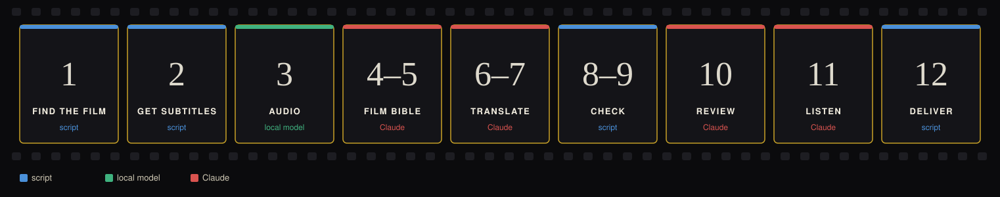
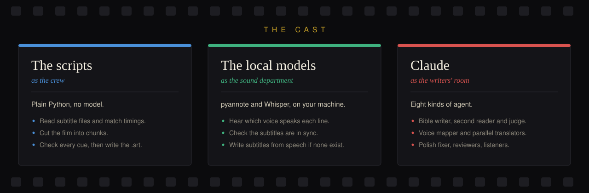
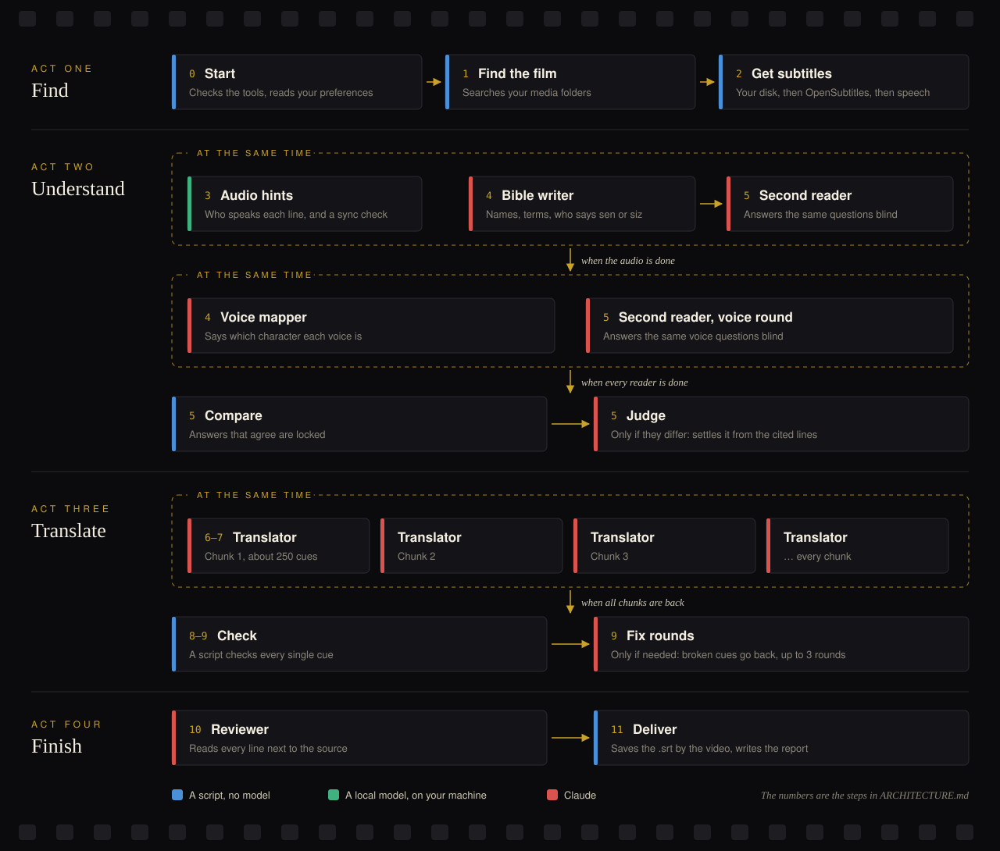

# How a run works

One command starts a run, and about a quarter of an hour later a Turkish
subtitle file sits next to the video. This page walks through what happens
in between, step by step. The step numbers match `skills/translate/SKILL.md`,
the skill Claude follows in your conversation for `/subtitle-it:translate`.

Turkish is the first supported language, and more are planned. Every run
today writes Turkish: the language rules sit in a Turkish language pack,
`pack-tr.md`, and the agents' instructions are written for Turkish.

## Who does what

The work is split by one rule: anything with one right answer is a script,
and anything that needs a feel for language is an agent.

- **Scripts** (`scripts/`) read subtitle files, match timings, cut chunks,
  check the translation, write the file and record the run's time. They
  are plain Python, tested, and print a JSON result.
- **Local models** listen to the audio on your machine: pyannote finds who
  speaks when, and Whisper checks the sync or, as a last resort, writes the
  subtitles from speech.
- **Subagents** do the language work: the film bible, the second reader,
  the judge, the voice mapper, one translator per chunk (or one polish
  fixer), one reviewer per part of the film and one listener per larger
  part. Each runs as its own agent type from `agents/`:
  the file holds its instructions and the few tools it may use, and leaves
  out the general Claude Code instructions and your CLAUDE.md files, which
  it does not need. The skill passes only the paths. Each one writes its
  files and replies with a short summary.

The main conversation never reads a whole subtitle file. It reads the
scripts' results, the bible and the review, so a full film fits in one
session.

## The whole run on one page

Read it top to bottom. A dashed gold frame means the boxes inside it run at the same time. The numbers match the steps below.

## The steps

### 0. Start

Checks that uv and ffprobe are installed, finds your settings folder
(moving the one from before the plugin was renamed into place, once),
reads your preferences, and mentions any delivered file you have edited
since.

### 1. Find the film

`sources.py find` searches your media folders.

- Copies of one film are picked without asking.
- Different films with a matching name (Harbour Lights and Harbour Light) are the one
  question a run asks.
- A film given by path from a folder not listed yet adds that folder
  (`sources.py remember`).
- A listed folder that is not there, such as an unplugged drive, is named
  when nothing is found.

### 2. Source subtitles

The run needs source subtitles to translate from, and tries three places
in order.

1. **On disk.** `sources.py local` reads text tracks inside the video, files
   next to it, and files in a `Subs` or `Subtitles` folder beside it.
2. **OpenSubtitles.** `opensubtitles.py` searches by the video's hash, then
   by IMDb id or title.
3. **The film's own speech.** With nothing usable from either,
   `transcribe.py` writes subtitles with Whisper, the last resort.

Then it settles the timings:

- The timing file is the one whose timing is most certain to fit this exact
  video.
- Other files are paired onto it by time only when `srt.py fit` says they
  line up after one constant shift (it ignores sound descriptions and
  songs). A shifted file is written with `srt.py shift` first.
- `prepare.py build` writes the work folder: `cues.json` (every cue with its
  source and English text) and `chunks.json` (about 250 cues each, cut at
  the longest pause).
- On-screen text: `build` also reads the film's other subtitle tracks
  (`--track`, `--forced-track`). A line two languages show, or a forced
  track shows, where the timing file shows nothing (a title card, a sign)
  joins the timing file as a cue of its own, marked `on_screen`. Such a
  cue is never marked a song, a sound or a bare sound, and `check` fails
  when one is left out. Every text found is a row of `W/on_screen.json`,
  added or left out with a reason: one language only (a French track also
  subtitles shouts), no room between two lines, a subtitle credit, a song
  line marked with `#`, or a sign two languages show during a song or a
  sound (a track also translates lyrics marked by italics alone, so it is
  recorded, not added). A line the timing file covers is its own line: it
  is only counted. The list is empty when no track is given, so no
  earlier run's entries survive.
- Unless your preferences say `Hearing-impaired tags: keep`, `build` takes
  sound descriptions in square brackets (`[door slams]`) and bracketed
  names (`[Mara]`, `[1. Man]`) out of every text. From a file that is
  hearing-impaired it also takes descriptions in parentheses (`(sighs)`)
  and labels in capitals (`MARA:`), but keeps a parenthesis that ends in
  ? or !, or holds a sentence with words on both sides, and capitals that
  do not look like a name (`OK:`, `DAY 3:`). Each label is kept as the
  cue's speaker hint. A cue that is only sounds is marked and left
  out of the translation and of the delivered file. `sources.py` calls a file hearing-impaired when at least 3% of its
  cues hold such tags or labels, whatever its name says.
- Whatever that setting says, `build` follows the Netflix Turkish style
  guide on bare sounds: a cue that is only "Oh.", "Hmm?" or "Uh, um..." is
  left out the same way (`left_out: "sound"`), since the audience hears
  it. A yes or no said as a sound ("Uh-huh.") right after a question stays,
  and the translator writes it as a word. A cue whose words are all song
  lyrics is marked `song`; step 6–7 decides which songs are translated.
  Lyrics are lines marked with `♪`, `♫` or `#`. A file that marks none
  that way may mark its songs with italics alone: there a run of at least
  four whole-italic cues that end no sentence counts as a song, while
  italic narration and phone voices, which end their sentences, stay
  speech.

The step also looks for a human-made Turkish subtitle. It tries at most two
files, a hash match first, and stops at the first one that passes
`srt.py fit`: one constant shift lines it up, and it covers at least 80%
of the timing file's spoken cues. Then the run is a polish run (see
steps 6–7).

### 3. Speaker hints (optional)

`speakers.py` finds who speaks each line from the audio and checks the
subtitles are in sync with it, from five 3-minute stretches spread over the
film.

- The check tries every offset up to 20 seconds either way and keeps the
  one where most speech starts land on a cue start. That offset must
  stand well above chance (the median count over all offsets) and above
  the best other offset, so fast, overlapping talk, where many starts
  land near some cue whatever the offset, still gives a clear answer.
- Subtitles more than 300 ms off are shifted with `srt.py shift`, and the
  voices are matched again. `build` runs again with `--shift-ms`: it moves
  the on-screen entries of `W/on_screen.json` by the same amount, rather
  than finding them again, and drops the same timing cues under them, so
  every cue keeps its number and the bible's citations stay true. The
  amount counts from the times the first build found, so running the
  same rebuild twice moves the entries once.
- A voice can gather several characters. When a voice has at least six
  cues with a speaker label and no character holds two thirds of them, its
  cues get no voice hint, and the address-form check leaves them alone.
  A hint that is wrong in one cue out of three is worse than none.
- Everything runs on your machine.
- It runs in the background while the bible is written, since it takes
  several minutes.

### 4. Film bible

A subagent reads the film once and writes down the decisions every
translator must share:

- `bible.md`: characters, the film's world and how its people talk (the
  words that world needs, such as "adak" for an offering to a god, and the
  ones whose tone belongs elsewhere), who says sen or siz to whom, fixed
  terms.
- `glossary.json`.
- `decisions.json`: each decision as a question, its answer, the cues that
  support it and how sure it is.
- `songs.json`, when the film has song cues: the songs that carry the
  story (sung on screen, or lyrics the scene plays against), by cue range.

sen/siz is read from the tone of each scene, not only the relationship on
paper: people at ease say sen, and a pair can shift for one scene (a cold
siz in a fight) and back. The fallback for an unclear pair is siz only for
formal relations; adults of about the same age at ease get sen. What a
speaker calls the listener ("man", "honey", "kid") goes on the same pair's
line, because Turkish picks the word from what the two are to each other:
one speaker's "man" can be "dostum" to a policeman and "kanka" to a friend.

It works from the text while the audio step runs. Once the voices are in, a
voice mapper subagent decides which character each voice is, and
`bible.py voices` adds those answers to the bible, so the check in step 5
covers them too.

### 5. Check the bible

A bible written by one reader can be confidently wrong, so a second reader
answers the same questions without seeing it.

1. `bible.py questions` strips the answers.
2. A second reader, who never sees the bible, answers the same questions
   from the subtitles. It starts as soon as the bible is written, while the
   audio step may still run.
3. The voice questions come from `bible.py voice-questions`, and another
   round of the second reader answers them beside the voice mapper.
4. `bible.py compare` locks what both agree on, and names the questions
   the second reader skipped, so it is asked those once more.
5. A judge reads only the cited cues for the rest and decides from the
   evidence or by a safe default.
6. `bible.py apply` writes the result. Anything settled by a safe default
   goes into the report.

### 6–7. Translate

First `prepare.py songs` applies the preferences' `Songs` (`story`,
`skip` or `all`): with `story`, every song cue not in `songs.json` is
marked `left_out: "song"`, gets no chunk line and is not delivered. Then
`chunks` writes the chunks again without them.

One subagent per chunk, all started at once. Each gets the Turkish language
pack (`pack-tr.md`), the bible, your preferences and its neighbours' chunks
for context.

The translators run at medium reasoning effort (`effort: medium` in
`agents/translator.md`), whatever effort the session uses. The fix rounds
of step 9 use the same agent, so they do too. Low effort cost about 17%
less per film and tied medium in a blind test of 100 cues, but that test
judged meaning, not how natural the Turkish sounds: on one test film a
second review found one line in five that a Turkish speaker would not say,
so the translators went back to medium. A Translator model of `sonnet`
also runs at medium effort.

**In a polish run** there are no translators:

- `polish.py seed` puts the Turkish file's text on the timing file's cues.
  Timing cues the file does not cover get no text; the check counts them
  as missing, and the polish fixer translates them. A Turkish line that
  lands on no cue is kept with its time in `polish_placement.json`; the
  report lists those that lie under no on-screen cue delivered, since the
  human translator may have subtitled a sign the tracks lack.
- `polish.py flags` lists the cues to fix: check fails, lines left in
  English, crude lines the Turkish tones down, and lines that may sit on
  the wrong cue. sen and siz are not among them: the human file is the
  evidence for them (below). Nor is `repeat drift`: a human file words a
  stock phrase ("What the fuck?") for each scene, and only a reviewer
  reading the scene can tell that from a callback.
- One polish fixer subagent changes only those.
- The step 10 reviewers start in the same message and read the film while
  the fixer works. Where the fixer and a reviewer change the same cue, the
  reviewer's version wins, and it fixes that cue's flags too.
- The human file is the evidence for sen and siz. `polish.py seed` also
  runs before the bible check, so `bible.py compare` can count the human
  file's sen and siz lines per pair: the judge gets the counts, and 3 or
  more human lines that use another form than both readers give, at the
  same cues, send the pair to the judge. The judge then follows the human
  file where three quarters of its lines for the pair use one form. A seeded line keeps its
  form; the fixer and the reviewers change it only when the English line
  itself shows the other one, and write why on an `#address:` line under
  the cue in their fix file. `check` lists every line whose form differs
  from the human file's (`address_changes` in `checks.json`) and warns on
  each one with no reason. A line written from scratch takes the human
  file's form for the same pair in the nearest scene.

### 8–9. Assemble and check

`assemble.py check` joins the chunks and checks every cue.

- **Hard fails** are missing, extra or empty cues, italics or dialogue
  dashes that differ from the source, a cue that cannot be laid out (see
  below), and square brackets in the Turkish, or a speaker label or a
  description in parentheses where the source cue had tags removed.
  Italics on single words beside plain ones (`<i>To</i> all the harbour
  crews`) are mostly a slip in the source file: the Turkish may leave
  them out, and a Turkish cue that keeps italics there only gets a `stray
  italics` warning. Hard fails go back to the chunk's translator, and
  after two rounds one more round runs on a stronger model. Each round
  starts with `assemble.py fixround`, which writes every failing cue's
  checks, source and current Turkish (seed or chunk output with every fix
  file applied) to `W/fixes/`. The translator edits that text, so the
  reviewed wording and the bible's terms stay.
- **Warnings** are reading speed above 17 characters a second (every
  such cue, even when the source is as fast), glossary variants, sen or
  siz against the bible, a plain "hala" or "aşık" that probably lacks its
  circumflex, and a few Turkish style checks, such as a line opening with
  "Ve" (`ve opening`). They go to the reviewers.
  A reading speed warning says `only the Turkish is fast` when the
  source reads at 17 characters a second or less. Both speeds are
  measured over the time the cue is shown, which for a fast cue may run
  into the silence after it (see the layout below). Meaning and natural
  Turkish come first: a reviewer reaches 17 only by a shorter natural
  wording or by dropping filler, and otherwise keeps the line, fast.
  Some keep the film consistent: a cue whose source says a term the bible
  decided but whose Turkish has none of the bible's rendering (`term
  rendering`), a second form of a word the rest of the film writes one way
  ("ağabey" among "abi", `term drift`), a TDK spelling slip ("sağol" for
  "sağ ol"), and a name suffix that does not fit how the name sounds
  ("Casey'in" for "Casey'nin"). `repeat drift` warns when a line the film says
  again in the same words (a chant, a saying, a callback) is written two
  ways in Turkish, and quotes the other wording, since the two cues often
  sit in different review parts. The check cannot tell such a line from a
  stock phrase anyone says ("Come on!", "What the fuck?"); the reviewer
  does, and words a stock phrase for its scene. `split sentence` looks at
  each run of cues whose source sentence goes on without a full stop, and
  warns when the
  Turkish writes a part twice, leaves a cue with nothing of its own, or
  puts a name in another cue than the one that says it. The address check
  leaves out a question and its answer heard as one voice, a name
  spoken about rather than to, and a cue whose form is the one the other
  side of the pair uses back while the audio gave the cue next to it the
  same voice and that other person is in the scene: there the speaker or
  the listener may be the wrong one. A speaker's own slip into the other
  side's form on two cues in a row is silent then too; the reviewers
  still read every cue's sen or siz. When the speaker uses different
  forms to different people and the line names nobody, the one other
  character speaking right before or after, in the same scene, is taken
  as the listener. A term's senses count together
  ("watch" and "the watch"), and a family word ("brother") takes every word
  the bible's family-word decisions give it ("abi" for one pair, "kardeş"
  for another), so a pair's decision is never flagged against a generic
  entry. `bible.py apply` lists such generic entries as `term_conflicts`.

The last part of the check lays out every cue as it is shown
(`layout.py`): at most 2 lines of 42 characters, and in a two-speaker cue
one line per speaker. A cue whose text fits two lines is rewrapped.
Turkish line breaks follow the Netflix Turkish guide (`turkish.py`): a
break after a sentence end or a comma comes first, then one before a
conjunction, and no second line starts with a word that leans on the
one before ("gibi", "diye", "mi", "de"). A two-line cue that already fits
but breaks badly is rewrapped when a better break fits. A
two-speaker cue that does not fit is split at the speaker change into one
cue per speaker. Its time is shared in proportion to each part's length,
and a part that would get under a second gets a second, taken from the
others. The file's usual gap goes between the parts. The split is made
only when every part lasts at least a second and reads at 17 characters a
second or less. Anything else is a hard fail. A cue whose Turkish reads
above 17 characters a second over its own time stays on screen into the
silence before the next cue, until it reads at 17: at most half a second
longer, never closer to the next cue than the file's usual gap, never
past 7 seconds on screen (`layout.available_end`). A split cue gives that
extra time to its last part. The draft is numbered from 1 as delivered, and
`cue_map.json` leads each delivered cue back to the timing file's cue; the
rest of the work folder keeps the timing file's numbers.

### 10. Review

`assemble.py reviewparts` cuts the film into parts of about 250 cues,
each ending at the longest pause near an even cut. Each part file holds
its cues side by side with the source, 20 cues of context on each
side, and each cue's notes, cut short: the check's warnings, the polish
fixer's flags and the translators' flags. A reading speed note shows only
where the Turkish alone is fast. A cue that is on-screen text shows
`on-screen text` as its speaker, here and in the listener's files, so it
is read as text on screen, not speech. The part file, the pack, the bible and
the preferences are all a reviewer reads, so a part costs little more
than its own cues. The reviewers run at medium reasoning effort
(`effort: medium` in `agents/reviewer.md`), whatever effort the session
uses: that is the effort the split review was tested and passed at, about
50,000 tokens per part. One reviewer per part, all at the same
time, compares every Turkish line with its source and asks of each:
is everything said there (each clause, question, name and number), is it
on the right cue, are the case endings and verb forms right, is sen or
siz right for who speaks to whom, are names and terms the bible's, does
it read at a glance, and, where only the Turkish is too fast, can it be
shorter without losing anything. A line that passes stays word for word.
In a polish run the reviewers rewrite a human line that leaves out part
of what is said, keeping its wording where it is right. A word the bible
prefers is not by itself a reason to change a human line: the human file
is the evidence for its words, as it is for its sen or siz.

The bible is the reviewers' default for sen/siz, but the scene decides:
they never turn a natural sen into siz only to match the bible, and list
each cue where they depart from it. Meaning comes before reading speed: a
fast line is shortened only by rephrasing or dropping filler, never by
dropping a clause, a question, a name or a second sentence. Each reviewer
writes its own fix file (`out/fix_review_<NN>.txt`) and notes;
`assemble.py reviews` joins the notes into `review.md`.

In a polish run, `polish.py soft` then lists the lines that are still
softer than the English swearing. The polish fixer restores them once, and
any line still soft goes to "Check after watching".

### 11. Listen

The reviewers compare each line with its source, so they catch what is
missing but not always what sounds translated. The listeners read the
other way round: the finished Turkish alone, in order, as a viewer reads
it, with the bible's `speaks` notes (how each character talks) and the
pairs' tone beside them. A line that does not sound like this person
saying this to this listener gets a fix; only then do they read the
English, to keep everything said. In a polish run they listen only to
the lines the run wrote: a line that still says the human file's words
is marked `human`, read for the scene and left alone, and a part with
only such lines gets no listener. The reviewers of a polish run can
change many lines (616 of 1,351 on one film), so those need the viewer's
ear too.

`assemble.py listenparts` saves the Turkish as it is (`out/listen_before.json`,
with the fix files it came from) and cuts the spoken cues into parts of
about 480. Each cue gets a budget, the most characters it may hold: 17 a
second over the most time it can be shown, its length now, or the first
draft's length, whichever is largest, so a line the review cut short can
always go back. It also names the cues that hold one source sentence and
the cues that say the same line elsewhere in the film.

`assemble.py listengate` is the safety net, as code. It runs the checks
on the text before and after the edits, without writing anything, and
compares problems by cue and kind. It drops an edit to a human line, an edit that goes over its
budget, or one whose cue, sentence or repeated line gains a hard fail or a new
warning about a repeated line, a split sentence, sen or siz, or a term;
then it checks again and drops whatever still causes a new problem. One
reviewer then reads each kept edit beside the line before it
(`listencheck`, the `Listener check` in `agents/reviewer.md`) and keeps
it, or writes the line before it back: never a third version, which no
check would see. The listener's files apply after every fix file that
existed when it started, and the meaning check's after them; a fix file
written later still wins. If the last `check` finds a hard fail on a cue
the listener changed, `listendrop` drops that edit. `review.md` ends with
the counts: kept, dropped by the gate (by reason), written back.

### 12. Deliver

`assemble.py deliver` writes `<film>.srt` next to the video, with exactly
the video's name so TVs pick it up, as UTF-8 with a BOM. Any file already
there is moved to a backups folder, and the result says what it was:
`earlier delivery`, `Turkish` or `not Turkish` (an English `<film>.srt`,
say). Unless the preferences turn the credit off, "İyi seyirler." opens
the file in the silence before the first line, and "Görüşmek üzere." comes
3 s after the story's last line: the last cue that is not `on_screen` (a
kept song counts as story). It takes the first free 2 s from there,
skipping any card in its way, and ends 0.1 s before the next one, so an
end title read from another track comes after it. With no free 2 s, or
no story cue at all, it follows the last cue by 3 s. With `--video` it
stays inside the video's length, moving earlier or ending with the video.
For an `.srt` input the name keeps the input's, with `tr` as its
language, so the input is never written over. When it delivers to that
default name next to the video (`--video`), this plugin's earlier
deliveries of the film under another name, such as a `<film>.tr.srt` from
before 0.6.2 or from the plugin's old name turkish-subtitles, go to the
backups folder too, so the TV finds one Turkish file. It knows them from
the `delivered.json` of every work folder, the old plugin's included, and
only moves a file that still holds Turkish. `sources.py local` reads the
same records, so such a file is never taken as a source. The cue map is kept with the
delivered copy, and with a backup of an earlier delivery, so the report,
learn mode and old files can still name each cue. `assemble.py where`
turns a work folder cue number into its delivered number and time.
`deliver` also returns the report's on-screen section: every on-screen cue
delivered (time, text), every entry left out before the first spoken line
or after the story's end (time, text, reason), counts for the rest with
the path of `W/on_screen.json`, and two lines on what no run finds: text
shown while someone speaks, and text in the middle of the film that no
subtitle track shows. `report.md` ends with "Check after
watching": what could not be settled for certain, with timestamps, kept out
of the chat so nothing is spoiled.

Before it, a "Time and usage" section gives the run's wall-clock time and
the time of each step group, from marks `usage.py step` made at the start
of each group, and each agent kind's count, tokens and time, from the
agents' completion notices. It names what a run cannot see: the main
session's own tokens and the split into new and cached tokens, so it gives
no cost in money. `usage.py summary` also saves the same figures as
`usage.json` in the work folder, so several films can be compared.
Agents are not waited on for their completion notice, which can come many
minutes after the work: `usage.py wait` returns once an agent's output
files exist and have stopped changing, and the run goes on from there.

## Learn mode

After you fix lines in a delivered file, `/subtitle-it:learn <film>`
runs `learn.py diff`, proposes up to five general rules from your edits,
and saves the ones you accept in your preferences. Every later run uses
them. It is its own skill, `skills/learn/SKILL.md`, so a translate run does
not carry its steps. It reads the language pack and the preferences
template from `skills/translate/` rather than keeping copies. The one-time
setup steps live in `setup.md` beside the translate skill, read only when
a step needs them.

## Files

- Your settings and credentials: `~/.config/subtitle-it/`. A settings
  folder from before the plugin was renamed is moved there once, by
  `settings.py`, without opening the files in it.
- One work folder per film, the download cache and the scripts' results:
  the plugin's data folder, which Claude Code deletes when you uninstall the
  plugin.
- Next to the video: only `<film>.srt` (`<film>.tr.srt` before 0.6.2;
  learn mode still finds those through each run's `delivered.json`).
