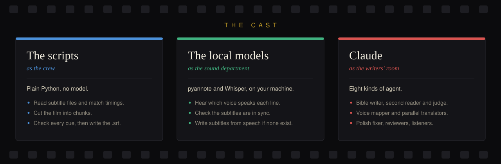

# Contributing

Issues and pull requests are welcome.

## Reporting a bug

A good bug report gives:

- the plugin version and your system
- the command you ran and what happened
- the part of the film's `report.md` about it

Never attach videos, subtitle files you may not share, or credentials.
The issue forms ask for exactly this. Security problems go to
[SECURITY.md](SECURITY.md).

## Set up

You need [uv](https://docs.astral.sh/uv/). The scripts declare their own
packages at the top of each file, so there is nothing else to install.

```
uv run --group dev pytest
uv run --group dev ruff check .
uv run --group dev ruff format --check .
```

CI runs the same three commands on Linux, macOS and Windows, with ffmpeg
installed. To try a change in Claude Code, start a session from the
repository folder with `claude --plugin-dir .`.

## How the work is split



| Kind of work | Where it lives |
| --- | --- |
| Exact work: parsing, timing, pairing, checks, delivery | `scripts/`, with tests in `tests/` |
| Language work in the conversation | The two skills in `skills/`: `translate` and `learn` |
| Language work in subagents | The agent types in `agents/` |

Each script prints a JSON result and, with `--result <file>`, saves it.
[How a run works](docs/reference/ARCHITECTURE.md) walks through a run.

## Never name a film

No doc, changelog entry, code comment, test, commit message, pull request
or release note names a film the plugin was run on.

| Write | Not |
| --- | --- |
| "On one 2026 film, 241 of 300 frames were sent" | The film's title |
| "one test film with 31 other languages" | The film's title and year |
| An invented title for an example: "Harbour Lights" | A real title |
| Invented people and lines in examples and test text | A real film's character names or quoted lines |

Keep the measurement and drop the name. `tests/test_no_film_names.py`
fails on a title followed by its year in brackets.

## Pull requests

- One change per pull request, with tests for new behaviour.
- Commit messages follow `type(scope): subject`, for example
  `fix(srt): keep italics across line breaks`.
- Never commit subtitles, video or credentials. `.gitignore` blocks the
  common file types.

## Writing docs

- No paragraph over three sentences.
- Thresholds and options go in a table, not in a sentence.
- Each fact has one home. Other pages link to it. Measured figures live
  in [Numbers](docs/reference/NUMBERS.md).
- A new page gets a line in [docs/INDEX.md](docs/INDEX.md).
- Every page opens with what it owns and who should read it.

## Releases

A release bumps the version in four places, which CI checks match:

1. `.claude-plugin/plugin.json`
2. `pyproject.toml`
3. `USER_AGENT` in `scripts/opensubtitles.py`
4. a new first entry in `CHANGELOG.md`

Each changelog entry opens with a paragraph in plain words that a user
can follow without knowing the code: what changes for them. Technical
bullets come after it.

Merging to `main` does the rest. `.github/workflows/release.yml` tags the
commit `v<version>` and publishes a GitHub release. Its notes are the
opening paragraph, the bullets folded under "Technical notes", how to
update, and links to the changelog entry and the changes since the last
tag.

Preview them with `python .github/scripts/release_notes.py <version>`.
