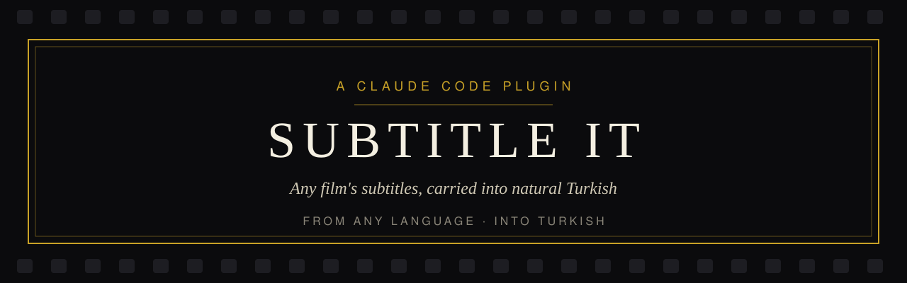
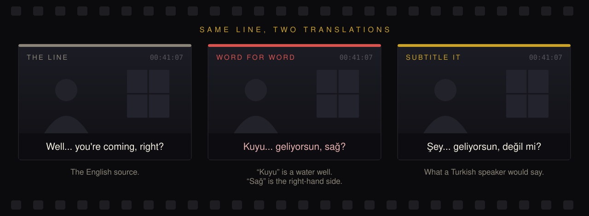
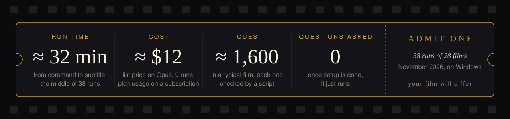
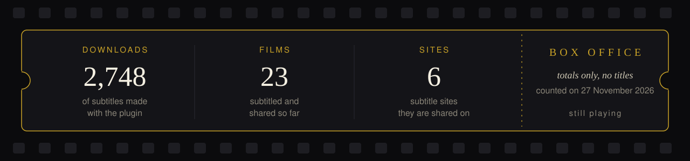
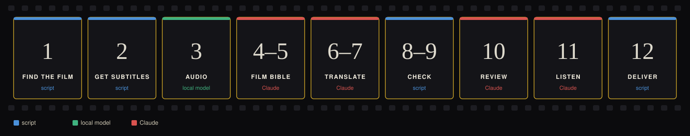
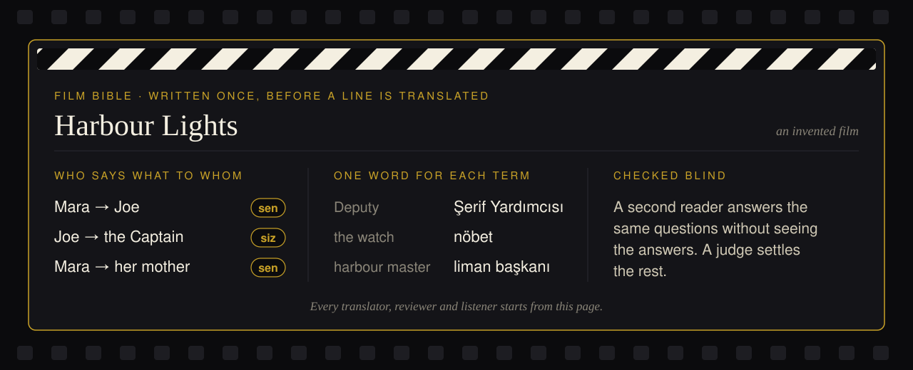
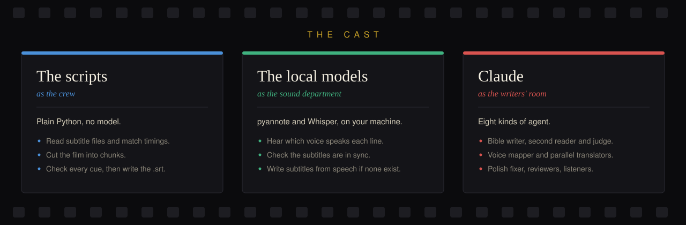
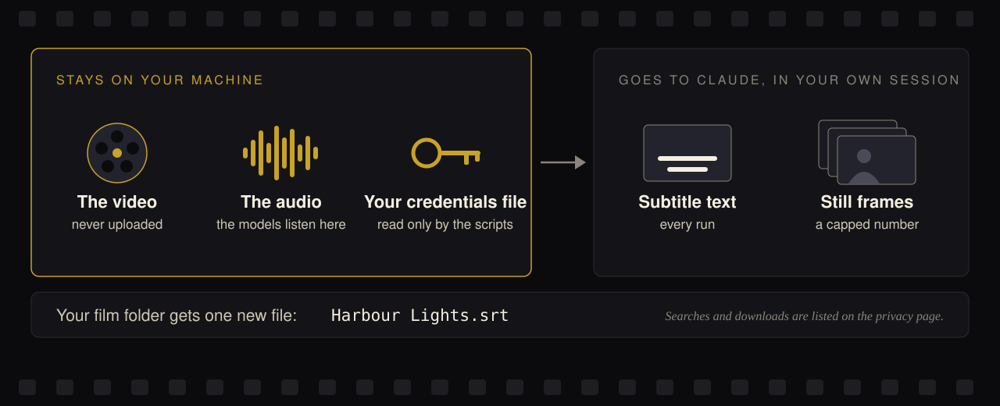
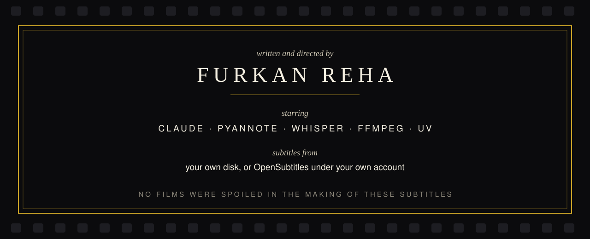

# Subtitle It



<p align="center">
  <b>Name a film. Get Turkish subtitles that sound like people talking.</b>
</p>

<p align="center">
  <a href="https://github.com/specialone0007/subtitle-it/actions/workflows/ci.yml"></a>
  <a href="https://github.com/specialone0007/subtitle-it/releases/latest"></a>
  <a href="LICENSE"></a>
</p>

<p align="center">
  <a href="#quick-start"></a>
  <a href="docs/reference/ARCHITECTURE.md"></a>
  <a href="docs/INDEX.md"></a>
  <a href="CHANGELOG.md"></a>
</p>

A Claude Code plugin that reads a film's subtitles in any language and
writes natural Turkish ones. You type one command:

```
/subtitle-it:translate Harbour Lights
```

When the run ends, `Harbour Lights.srt` sits next to
`Harbour Lights.mkv`, under exactly the video's name.



## What you get


After watching, fix lines in the file and run
`/subtitle-it:learn Harbour Lights`. Fixes you repeat become rules.

## The numbers





On a Claude subscription a run uses your plan's usage, not dollars.
[Numbers](docs/reference/NUMBERS.md) has every figure and how it was
measured.

## Quick start

1. **Install the plugin** in your shell:

   ```
   claude plugin marketplace add specialone0007/subtitle-it
   claude plugin install subtitle-it@subtitle-it
   ```

2. **Install uv and ffmpeg:**

   | System | Commands |
   | --- | --- |
   | Windows | `winget install astral-sh.uv` and `winget install Gyan.FFmpeg` |
   | macOS | `curl -LsSf https://astral.sh/uv/install.sh \| sh` and `brew install ffmpeg` |
   | Debian, Ubuntu | `curl -LsSf https://astral.sh/uv/install.sh \| sh` and `sudo apt install ffmpeg` |

3. **Run it.** Start a new Claude Code session and type
   `/subtitle-it:translate <film>`.

[Setup](docs/getting-started/SETUP.md) has the optional extras and what
to do when a step fails.

## How a run goes



Thirteen steps, numbered 0 to 12, in four acts. Before a line is
translated, the run writes the film's bible:





When a human-made Turkish subtitle already exists, the run polishes that
file instead of translating from scratch.

## What leaves your machine



[Files and privacy](docs/reference/PRIVACY.md) lists everything that is
sent, to whom, and when.

## Start here

1. **[Setup](docs/getting-started/SETUP.md)** - your first film.
2. **[How a run works](docs/reference/ARCHITECTURE.md)** - every step on
   one page.
3. **[All docs](docs/INDEX.md)** - the index of every page.
4. **[AGENTS.md](AGENTS.md)** - for contributors and coding agents.

## The small print

<details>
<summary><b>What it needs</b></summary>

- **[Claude Code](https://code.claude.com/docs),** on a plan with room
  for a run.
- **uv and ffmpeg,** from the quick start.
- **Subtitles in a text format:** SRT, ASS, WebVTT or a text track inside
  the video. Image subtitles (PGS, VobSub) are not read. With no subtitle
  anywhere, it writes one from the audio.
- **Windows, macOS or Linux.** Full runs have only been tested on
  Windows. On macOS and Linux, CI runs the test suite, and a full run is
  untested.

It translates from any language, into Turkish only. You are responsible
for having the right to use the films and subtitles you run it on.

</details>

<details>
<summary><b>Working on the plugin</b></summary>

| Folder | What is there |
| --- | --- |
| `skills/` | The two commands, `translate` and `learn`, and the Turkish language rules |
| `agents/` | The nine agent types: their instructions and allowed tools |
| `scripts/` | The Python scripts, one job each |
| `tests/` | The pytest suite |
| `docs/` | The docs and the pictures |

Load the plugin from a clone with `claude --plugin-dir .`.
[CONTRIBUTING.md](CONTRIBUTING.md) has the checks and how to send a
change. [SECURITY.md](SECURITY.md) covers credentials and how to report
a problem.

</details>

## License

Apache-2.0, copyright 2026 Furkan Reha. See [LICENSE](LICENSE) and
[NOTICE](NOTICE).

<details>
<summary><b>Third-party parts</b></summary>

The plugin bundles no third-party code or models; the scripts download
what they need when they first run.

- The pyannote speaker models are gated on Hugging Face and come under
  their own terms, which you accept there with your own account.
- Whisper and faster-whisper, used for speech-to-text, are MIT-licensed.
- ffmpeg is not bundled; you install it yourself.

</details>

## Credits

<p align="center">
  <a href="https://www.linkedin.com/in/furkanreha/"></a>
</p>

<p align="center">
  <a href="https://www.linkedin.com/in/furkanreha/"></a>
</p>
