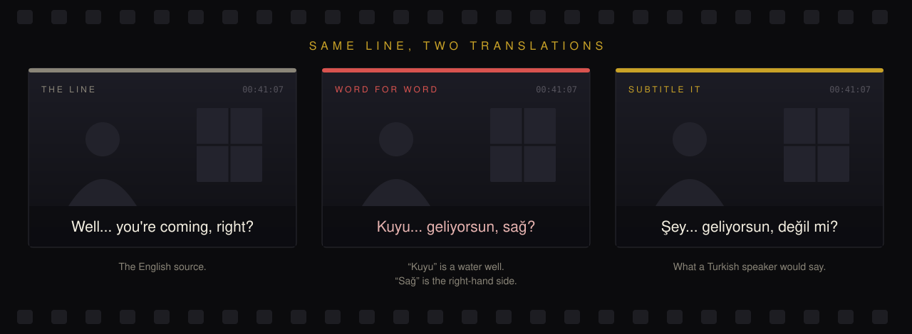
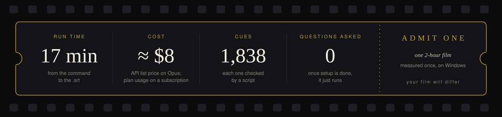
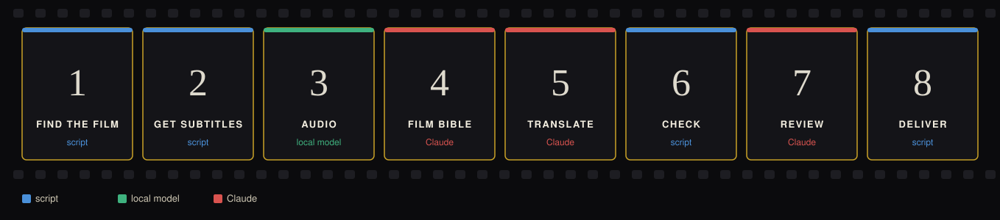
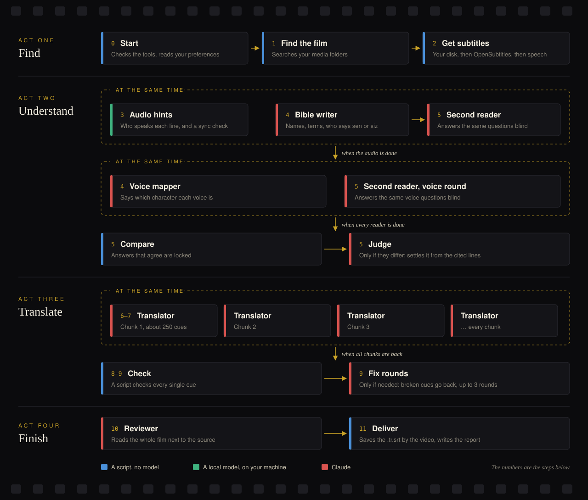
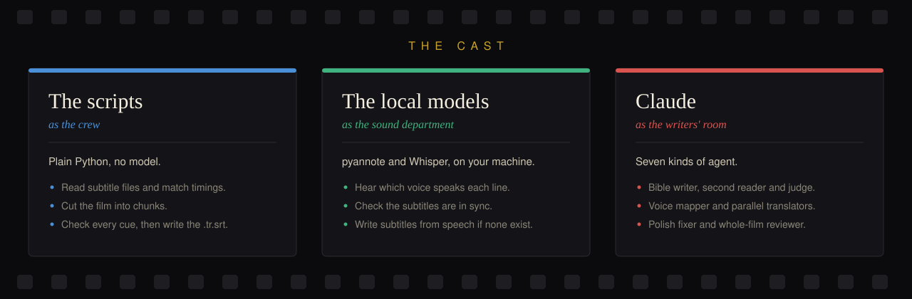

# Subtitle It


<p align="center">
  <b>Name a film. Get Turkish subtitles that sound like people talking.</b>
</p>

<p align="center">
  <a href="#quick-start"></a>
  <a href="#how-a-run-goes"></a>
  <a href="#cost-time-and-platforms"></a>
  <a href="ARCHITECTURE.md"></a>
</p>

A Claude Code plugin for people who want to watch a film that has no good
subtitles in their language. Turkish is the first supported language, and
more are planned; today every run writes Turkish. You type one command:

```
/subtitle-it:translate Inception
```

About a quarter of an hour later, `Inception.srt` sits next to
`Inception.mkv`, on the source file's own timings. It has exactly the
video's name, so a TV playing the film from a USB stick picks it up. (Plain `/translate` also works
when no other command uses that name.)



## What you get

- **Natural Turkish, never word for word.** Fillers and commands are translated
  by meaning, the way people in the scene would talk.
- **One voice for the whole film.** A short "film bible" fixes the names, the
  terms and who says *sen* or *siz* to whom, before anyone translates a line.
- **The original timings, easy to read.** Cues keep the source's times
  and italics, with at most two lines of 42 characters. In a cue with two
  speakers each speaker gets one line; when they cannot, and there is time
  for it, the cue is split into one cue per speaker, which share its time.
  Nothing is merged.
- **No hearing-impaired clutter.** Sound descriptions in square brackets
  (`[door slams]`) are taken out. From a hearing-impaired file, sound
  descriptions in parentheses (`(sighs)`) and speaker labels (`SANDRA:`) go
  too; in other files parentheses and capitals are often dialogue, so they
  stay. A cue that is only a sound is left out. Set `Hearing-impaired tags`
  to `keep` in your preferences to keep them all.
- **No questions, no spoilers.** Once setup is done it runs to the end. The
  one question it may ask is which film you mean when a name matches several
  (Alien and Aliens). It does not discuss the plot in chat.
- **An honest report.** What it could not settle for certain goes under
  "Check after watching" in the film's `report.md`, with timestamps. The
  report also gives the run's time per step and its subagents' tokens.
- **It learns from you.** Fix lines after watching, and it turns your edits
  into rules for the next film.



## How a run goes



The strip above is the short version. This is the whole run, in four acts.
A dashed gold frame means the boxes inside it run at the same time.



When a human-made Turkish subtitle already exists, the run polishes that
file instead of translating from scratch, which uses less. It looks on
your disk first, then on OpenSubtitles, which leaves out machine
translations. It tries up to two files, a match for this exact video
first, and uses the first one that fits the video's timings and covers at
least 80% of the spoken lines. Lines that file lacks are translated.



[How a run works](ARCHITECTURE.md) explains every step in plain words: what it reads, what it
writes, and why it is there.

## Quick start

1. **Install the plugin** in your shell:

   ```
   claude plugin marketplace add specialone0007/subtitle-it
   claude plugin install subtitle-it@subtitle-it
   ```

   Claude Code loads plugins when a session starts, so start a new session
   after installing; a session that is already open does not see the plugin.
2. **Install uv**, which runs the scripts and installs their packages on first use:
   - Windows: `winget install astral-sh.uv`
   - macOS / Linux: `curl -LsSf https://astral.sh/uv/install.sh | sh`
3. **Install ffmpeg and ffprobe** on PATH, which read subtitle tracks inside videos:
   - Windows: `winget install Gyan.FFmpeg`
   - macOS: `brew install ffmpeg` · Debian/Ubuntu: `sudo apt install ffmpeg`
4. **Run it.** Start a new Claude Code session and run
   `/subtitle-it:translate <film>`. The first time, it asks for the
   folder that holds your films and saves it in `preferences.md`.

That is enough for any film that has subtitles on disk. Two extras are
optional. If a film needs one and its setup is not done, the plugin prints
the setup command to run in your own terminal.

<details>
<summary><b>OpenSubtitles</b>: for films without subtitles on disk</summary>

Create a free API key at <https://www.opensubtitles.com/consumers> and a
free account. The first time a film needs it, the plugin prints a setup
command with the full path to run in your own terminal; it asks for the key
and login without showing them. From a clone of this repo the command is:

```
uv run scripts/opensubtitles.py setup --config ~/.config/subtitle-it
```

A key alone allows 5 downloads a day; with the free account login, 20.
Downloads are cached.

</details>

<details>
<summary><b>Audio hints</b>: tells the translators which voice speaks each line</summary>

Create a free read token at <https://huggingface.co/settings/tokens>, accept
the terms of <https://huggingface.co/pyannote/speaker-diarization-3.1> and
<https://huggingface.co/pyannote/segmentation-3.0> with the same account,
then run the setup command in your own terminal (the plugin prints it with
the full path; it asks for the token without showing it):

```
uv run scripts/speakers.py setup --config ~/.config/subtitle-it
```

The first run downloads a few GB (PyTorch, pyannote and a Whisper model).
With an NVIDIA GPU it takes a few minutes per film; on the CPU about as long
as the film. When the subtitles are out of sync with the audio, it moves
them to match and says so in the report.

</details>

<details>
<summary><b>Speech-to-text</b>: the last resort, when no subtitle file exists anywhere</summary>

It needs no setup and no token. Its first use downloads a few GB: PyTorch,
unless the audio hints already did, plus a Whisper model of about 1.6 GB.
With an NVIDIA GPU a film takes a few minutes, on the CPU about as long as
the film or more.

</details>

## What it needs

- [Claude Code](https://code.claude.com/docs). A feature film takes about
  one million new tokens plus about eight million cheaper cached reads. The
  parallel translators use the largest share, about a quarter (they run at
  low reasoning effort), so a plan with room for that helps. Polishing an
  existing Turkish file uses less.
- uv and ffmpeg (Quick start above). OpenSubtitles and audio hints are optional.
- Subtitles in a text format (SRT, ASS, WebVTT, or a text track inside the
  video). Image subtitles (PGS, VobSub) are not read.

You are responsible for having the right to use the films and subtitles you
run it on. The plugin reads only the folders you give it and downloads from
OpenSubtitles under your own account.

## Cost, time and platforms

Measured on one 2-hour film on Windows: about 17 minutes per run, and about
$8 at API list prices with Opus. On a Claude subscription a run uses your
plan's usage instead. Other films, models and machines will differ. Each
run's `report.md` gives its own time per step and its subagents' tokens,
and the work folder keeps them in `usage.json`.

Full runs have only been tested on Windows. On macOS and Linux, CI runs the
test suite, including one test that builds a short video and reads its
subtitle track with the real ffmpeg; a full run there is untested. Without
an NVIDIA GPU, audio hints and speech-to-text still work but take about as
long as the film, or more for speech-to-text.

## Where files go

| Place | What is there |
| --- | --- |
| Next to the video | `<film>.srt`, with exactly the video's name and saved as UTF-8 with a BOM, so TVs find it and show ş, ğ and ı. A file already there under that name, such as an English `<film>.srt`, is moved to `backups/` first. Nothing else is written into your film folders. |
| `~/.config/subtitle-it/`<br>(on Windows `C:\Users\<you>\.config\subtitle-it\`) | `preferences.md` (media folders, translator model, audio hints, hearing-impaired tags, swearing, titles, learned rules), `credentials.json` (OpenSubtitles and Hugging Face; only the scripts read it), and `backups/` (files a new subtitle replaced). Kept when the plugin is uninstalled. A settings folder from before the plugin was renamed is moved here, once, the first time it is needed. |
| The plugin's data folder<br>(`~/.claude/plugins/data/subtitle-it-.../`) | One work folder per film with the bible, the delivered copy and a report, plus the download cache and `results/`, where each script saves its last JSON result. **Uninstalling the plugin deletes it.** |

The skill reads the files in `results/` rather than the scripts' printed
output, so a shell or tool that shortens command output does not get in the way.

## What leaves your machine

- **Subtitle text** goes to Claude as part of your Claude Code session.
- **OpenSubtitles** receives your OpenSubtitles username and password when
  the plugin logs in. A search sends the video's hash, the title or IMDb
  id, the year when it is known, and the subtitle languages wanted.
  The subtitle file itself comes from the https address OpenSubtitles
  links to, which can be another host, and no key or token is sent with it.
- **Web search** receives the film's title and year. The skill looks them
  up once when it does not know them, and the bible writer and second
  reader search for the cast and plot.
- **Audio** never leaves. Audio hints and speech-to-text run locally.
  Audio hints download the pyannote models from Hugging Face with your
  Hugging Face token. The speech model is downloaded once from Hugging
  Face; that download needs no token and sends none, unless `HF_TOKEN`
  is set in your environment or you have logged in with the Hugging
  Face command line tool: the Hugging Face library then sends that
  token with it.
- **Packages** are downloaded the first time each script runs: Python
  packages from PyPI, and PyTorch from download.pytorch.org on Windows
  and Linux. When no installed Python fits a script, uv may also download
  a Python build.
- **Credentials** are typed into your own terminal, never into the chat, and
  kept in `credentials.json`. The OpenSubtitles key and login go only to
  OpenSubtitles, and the Hugging Face token only to Hugging Face.

[SECURITY.md](SECURITY.md) has the details and how to report a problem.

## Learning from your fixes

After watching, fix lines in the delivered `.srt` with any editor, then run
`/subtitle-it:learn Inception`. It proposes
general rules from your edits ("Always use 'Tamam' for 'OK'?") and saves
only the ones you accept. Each new run also checks for edited files.

## Development

To work on the plugin itself, load it from a clone for one session: in
the repository folder, start Claude Code with `claude --plugin-dir .`.

```
uv run --group dev pytest
uv run --group dev ruff check .
uv run --group dev ruff format --check .
```

CI runs the same three commands on Linux, macOS and Windows, with ffmpeg
installed. See [CONTRIBUTING.md](CONTRIBUTING.md) to send a change, and
[CHANGELOG.md](CHANGELOG.md) for what changed in each version.

<details>
<summary><b>Layout</b>: what lives where in the repo</summary>

```
.claude-plugin/plugin.json      plugin manifest
.claude-plugin/marketplace.json marketplace that lists the plugin
skills/translate/SKILL.md       /subtitle-it:translate, the run (steps 0-11)
skills/translate/setup.md       one-time setup, read only when a step needs it
skills/translate/pack-tr.md     Turkish language rules, shared with learn
skills/translate/preferences-template.md
                                the first preferences file, shared with learn
skills/learn/SKILL.md           /subtitle-it:learn, rules from your fixes
agents/                         subagent types: bible writer, second reader, judge, voice mapper,
                                translator, polish fixer, reviewer (instructions and allowed tools)
scripts/srt.py                  parse, encodings, pairing by time, chunking
scripts/sources.py              find films, extract tracks, validate sources
scripts/opensubtitles.py        OpenSubtitles login, search, download
scripts/prepare.py              build the work folder and chunks
scripts/bible.py                questions, blind comparison and judging for the film bible; adds the voices
scripts/polish.py               start from an existing Turkish subtitle: seed it, list cues to fix
scripts/assemble.py             assemble, checks, review file, delivery
scripts/learn.py                find user edits for learn mode
scripts/speakers.py             voices per cue from the audio, sync check
scripts/transcribe.py           subtitles from the audio when no file exists, the last resort
scripts/settings.py             find the settings folder; move the one from before the rename
scripts/result.py               print each script's JSON result and save it to --result
tests/                          pytest suite
ARCHITECTURE.md                 how a run works, step by step
docs/assets/                    the pictures in this file and in the architecture doc
```

</details>

## License

Copyright 2026 Furkan Reha

Apache-2.0: the Apache License, version 2.0. See [LICENSE](LICENSE)
and [NOTICE](NOTICE).

The plugin bundles no third-party code or models; the scripts download
what they need when they first run.

- The pyannote speaker models are gated on Hugging Face and come under
  their own terms, which you accept there with your own account.
- Whisper and faster-whisper, used for speech-to-text, are MIT-licensed.
- ffmpeg is not bundled; you install it yourself (see Quick start).

## Credits

<p align="center">
  <a href="https://www.linkedin.com/in/furkanreha/"></a>
</p>

<p align="center">
  <a href="https://www.linkedin.com/in/furkanreha/"></a>
</p>
