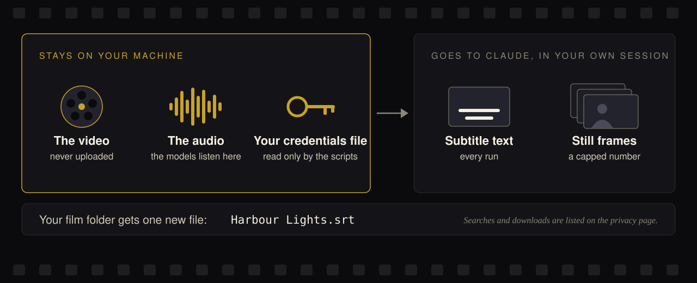

# Security

## Reporting a problem

Please report a security problem privately through GitHub's
[private vulnerability reporting](https://github.com/specialone0007/subtitle-it/security/advisories/new),
not in a public issue.

## Your credentials

The plugin can hold an OpenSubtitles API key and login, and a Hugging
Face token.

- **You type them into a setup command in your own terminal,** never into
  the chat.
- **They are saved in `~/.config/subtitle-it/credentials.json`,** with
  owner-only permissions where the system supports it. Only the scripts
  read the file.
- **The file is plain text.** It holds your OpenSubtitles API key,
  username and password, the login token, and your Hugging Face token,
  none of them encrypted. Anyone who can read files as your user, or a
  backup of your home folder, can read them.

| Credential | Sent only to | For |
| --- | --- | --- |
| OpenSubtitles key and login | OpenSubtitles | Logging in and searching |
| Hugging Face token | Hugging Face | Downloading the speaker models |

API requests that carry the OpenSubtitles key or token follow a redirect
only to opensubtitles.com over https. The subtitle file itself is
fetched from the https address OpenSubtitles links to, which can be
another host, with no key or token.

## Model files run as code

Audio hints load the pyannote model checkpoints with PyTorch's full
pickle loading (`TORCH_FORCE_NO_WEIGHTS_ONLY_LOAD=1` in
`scripts/speakers.py`). Those checkpoints do not load in its weights-only
mode.

Full loading can run code stored in a checkpoint. So the plugin trusts
the files from pyannote's own repositories on Hugging Face. A tampered
checkpoint there, or in your Hugging Face cache, could run code on your
machine.

## The speech model and your Hugging Face login

Speech-to-text downloads its Whisper model from Hugging Face once. The
download needs no token and sends none, with one exception: when
`HF_TOKEN` is set in your environment, or you have logged in with the
Hugging Face command line tool, the Hugging Face library sends that
token with it. The token in `credentials.json` is never used for it.

## What leaves your machine

Subtitle text and a capped number of still frames go to Claude as part
of your Claude Code session. The video and the audio never leave.
[Files and privacy](docs/reference/PRIVACY.md) lists everything that is
sent, to whom, and when.
