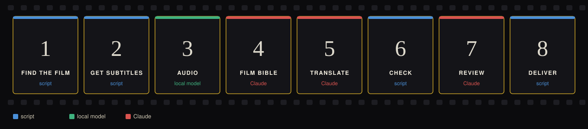
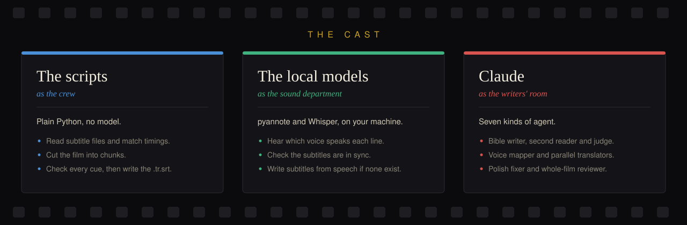
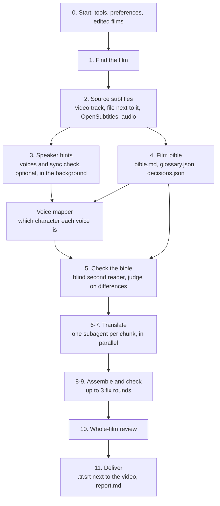

# How a run works

One command starts a run, and about a quarter of an hour later a Turkish
subtitle file sits next to the video. This page walks through what happens
in between, step by step. The step numbers match `skills/subtitle/SKILL.md`,
the one skill Claude follows in your conversation.

## Who does what

The work is split by one rule: anything with one right answer is a script,
and anything that needs a feel for language is an agent.

- **Scripts** (`scripts/`) read subtitle files, match timings, cut chunks,
  check the translation and write the file. They are plain Python, tested,
  and print a JSON result.
- **Local models** listen to the audio on your machine: pyannote finds who
  speaks when, and Whisper checks the sync or, as a last resort, writes the
  subtitles from speech.
- **Subagents** do the language work: the film bible, the second reader,
  the judge, the voice mapper, one translator per chunk (or one polish
  fixer) and one reviewer. Each runs as its own agent type from `agents/`:
  the file holds its instructions and the few tools it may use, and leaves
  out the general Claude Code instructions and your CLAUDE.md files, which
  it does not need. The skill passes only the paths. Each one writes its
  files and replies with a short summary.

The main conversation never reads a whole subtitle file. It reads the
scripts' results, the bible and the review, so a full film fits in one
session.

## The whole run on one page

## The steps

### 0. Start

Checks that uv and ffprobe are installed, reads your preferences, and
mentions any delivered file you have edited since.

### 1. Find the film

`sources.py find` searches your media folders.

- Copies of one film are picked without asking.
- Different films with a matching name (Alien and Aliens) are the one
  question a run asks.
- A film given by path from a folder not listed yet adds that folder
  (`sources.py remember`).
- A listed folder that is not there, such as an unplugged drive, is named
  when nothing is found.

### 2. Source subtitles

The run needs subtitles in the film's language, and tries three places in
order.

1. **On disk.** `sources.py local` reads text tracks inside the video, files
   next to it, and files in a `Subs` or `Subtitles` folder beside it.
2. **OpenSubtitles.** `opensubtitles.py` searches by the video's hash, then
   by IMDb id or title.
3. **The film's own speech.** With nothing usable from either,
   `transcribe.py` writes subtitles with Whisper, the last resort.

Then it settles the timings:

- The timing file is the one whose timing is most certain to fit this exact
  video.
- Other files are paired onto it by time only when `srt.py fit` says they
  line up after one constant shift (it ignores sound descriptions and
  songs). A shifted file is written with `srt.py shift` first.
- `prepare.py build` writes the work folder: `cues.json` (every cue with its
  source and English text) and `chunks.json` (about 250 cues each, cut at
  the longest pause).

The step also looks for a human-made Turkish subtitle. When one passes
`srt.py fit`, the run is a polish run (see steps 6–7).

### 3. Speaker hints (optional)

`speakers.py` finds who speaks each line from the audio and checks the
subtitles are in sync with it, from five 3-minute stretches spread over the
film.

- Subtitles more than 300 ms off are shifted with `srt.py shift`, and the
  voices are matched again.
- Everything runs on your machine.
- It runs in the background while the bible is written, since it takes
  several minutes.

### 4. Film bible

A subagent reads the film once and writes down the decisions every
translator must share:

- `bible.md`: characters, who says sen or siz to whom, fixed terms.
- `glossary.json`.
- `decisions.json`: each decision as a question, its answer, the cues that
  support it and how sure it is.

It works from the text while the audio step runs. Once the voices are in, a
voice mapper subagent decides which character each voice is, and
`bible.py voices` adds those answers to the bible, so the check in step 5
covers them too.

### 5. Check the bible

A bible written by one reader can be confidently wrong, so a second reader
answers the same questions without seeing it.

1. `bible.py questions` strips the answers.
2. A second reader, who never sees the bible, answers the same questions
   from the subtitles. It starts as soon as the bible is written, while the
   audio step may still run.
3. The voice questions come from `bible.py voice-questions`, and a second
   second reader answers them beside the voice mapper.
4. `bible.py compare` locks what both agree on.
5. A judge reads only the cited cues for the rest and decides from the
   evidence or by a safe default.
6. `bible.py apply` writes the result. Anything settled by a safe default
   goes into the report.

### 6–7. Translate

One subagent per chunk, all started at once. Each gets the Turkish language
pack (`pack-tr.md`), the bible, your preferences and its neighbours' chunks
for context.

The translators run at low reasoning effort (`effort: low` in
`agents/translator.md`), whatever effort the session uses. The fix rounds
of step 9 use the same agent, so they do too. On one 2-hour film (1,838
cues) this cost about 17% less per film than medium effort and finished
steps 6 to 10 1.4 minutes sooner, with no measurable loss in a blind test
of 100 cues (medium preferred on 20, low on 15, 65 equal). A Translator
model of `sonnet` also runs at low effort; that is untested.

**In a polish run** there are no translators:

- `polish.py seed` puts the Turkish file's text on the timing file's cues.
- `polish.py flags` lists the cues to fix: check fails, lines left in
  English, crude lines the Turkish tones down, and lines that may sit on
  the wrong cue.
- One polish fixer subagent changes only those.
- The step 10 reviewer starts in the same message and reads the film while
  the fixer works. Where both change a flagged cue, the fixer's version
  wins.

### 8–9. Assemble and check

`assemble.py check` joins the chunks and checks every cue.

- **Hard fails** are missing, extra or empty cues, italics or dialogue
  dashes that differ from the source, and too many lines. They go back to
  the chunk's translator, and after two rounds one more round runs on a
  stronger model.
- **Warnings** are long lines, fast reading speed, glossary variants, sen or
  siz against the bible, and a few Turkish style checks. They go to the
  reviewer.

### 10. Review

One subagent reads the whole film side by side with the source and fixes
what the chunk translators could not see.

In a polish run, `polish.py soft` then lists the lines that are still
softer than the English swearing. The polish fixer restores them once, and
any line still soft goes to "Check after watching".

### 11. Deliver

`assemble.py deliver` writes `<film>.tr.srt` next to the video and moves any
older Turkish file to a backups folder. `report.md` ends with "Check after
watching": what could not be settled for certain, with timestamps, kept out
of the chat so nothing is spoiled.

## Learn mode

After you fix lines in a delivered file, `/turkish-subtitles:subtitle learn
<film>` runs `learn.py diff`, proposes up to five general rules from your
edits, and saves the ones you accept in your preferences. Every later run
uses them. Its steps live in `skills/subtitle/learn.md`, and the one-time
setup steps in `setup.md` beside it, so a normal run does not carry them.

## Files

- Your settings and credentials: `~/.config/turkish-subtitles/`.
- One work folder per film, the download cache and the scripts' results:
  the plugin's data folder, which Claude Code deletes when you uninstall the
  plugin.
- Next to the video: only `<film>.tr.srt`.
