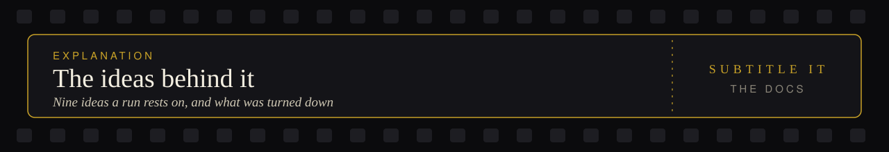
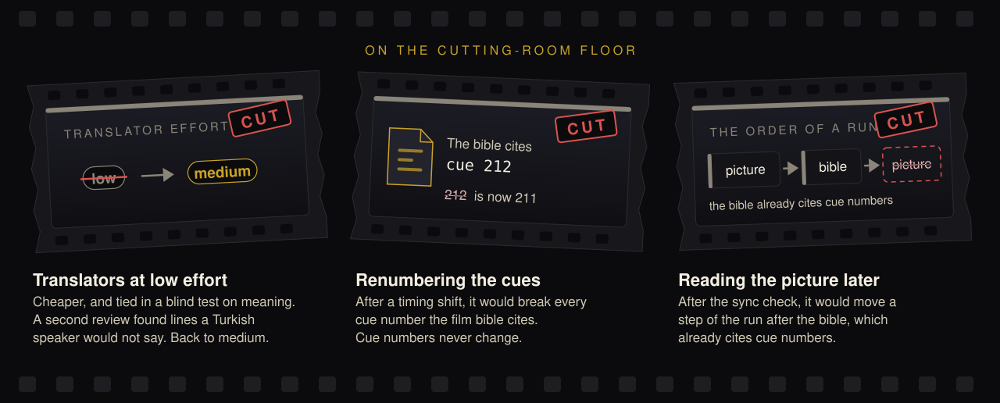

# The ideas behind it

> **This document owns:** why the plugin is built the way it is: the nine
> ideas a run rests on, what was tried and turned down, and what it
> deliberately does not do.

Read this if you are weighing whether to use it, or you are building
something like it and want the reasoning, not the rules. The rules are
in [How a run works](../reference/ARCHITECTURE.md).

## What it does

It reads a film's subtitles in any language and writes Turkish ones that
sound like people talking. One command starts it. It asks no questions
on the way, unless a name matches several films, and it does not discuss
the plot.

## Who uses it, and how

Someone who wants to watch a film that has no good Turkish subtitles.
They name the film, wait for the run to finish, and press play
([Numbers](../reference/NUMBERS.md#run-time) says how long that takes).
Afterwards they can fix lines and have the plugin learn from the fixes.

## Nine ideas

Each idea gets one line here. Its reasoning is folded under it.

### 1. One right answer is a script's job

Code does what has one right answer, and a model does only the language.

<b>The reasoning</b>

Matching timings, counting characters and checking italics each have one
right answer. Code does those, with tests. A model does only what needs
a feel for language.

This keeps the model's attention on the Turkish and makes every
mechanical step repeatable.

### 2. Decide once, before anyone translates

One reader writes the film's decisions down before any translator starts.

<b>The reasoning</b>

Translators working at the same time, one for each chunk of the film,
will each pick their own word for a rank, and their own *sen* or *siz* for a couple. So one reader
goes through the whole film first and writes the decisions down: the
film bible. Every translator then starts from the same page.

### 3. A second reader who never sees the answer

A second reader answers the same questions without seeing the answers.

<b>The reasoning</b>

A bible written by one reader can be confidently wrong. A second reader
gets the same questions with the answers stripped, and answers them on
its own, from the subtitles and a web search for the cast and plot.

What both agree on is locked. A judge settles the rest by reading the
cues each side cites.

### 4. The conversation never reads the film

Agents read the subtitle files. The main conversation reads their short
summaries and the scripts' results, never the subtitles.

<b>The reasoning</b>

Each agent gets paths, reads its own files and replies with a short
summary. The main conversation reads results, not subtitles. That is why
a two-hour film fits in one session.

### 5. Read it twice, in two directions

A reviewer reads each line against its source, and a listener reads the
Turkish alone.

<b>The reasoning</b>

A reviewer compares each line with its source, and catches what is
missing. A listener reads the finished Turkish alone, the way a viewer
does, and catches what sounds translated. Each pass finds what the other
cannot.

### 6. The safety net is code

A script checks every listener edit and drops one that adds a problem.

<b>The reasoning</b>

A listener's edit is free writing, so it could break something a check
had already passed. A script runs the checks before and after each edit
and drops any edit that adds a problem.

A reviewer then keeps the edit or restores the old line. It never writes
a third version, which no check would see.

### 7. A human translator's work is evidence

A human-made Turkish subtitle is polished, not replaced.

<b>The reasoning</b>

When a human-made Turkish subtitle exists, the run polishes it. The
human file's *sen* and *siz*, and its choice of words, are treated as
evidence about the film. A line is changed only where something is
missing or wrong, never to match the plugin's own taste.

### 8. Meaning before reading speed

A line is never made faster to read by cutting meaning.

<b>The reasoning</b>

A line that is too fast to read is shortened only by a more natural
wording or by dropping filler. It is never shortened by dropping a
clause, a question or a name. Where that is not enough, the cue stays on
screen longer, into the silence after it.

### 9. An honest report, kept out of the chat

What the run could not settle goes into the report, not into the chat.

<b>The reasoning</b>

What the run could not settle for certain goes into the report under
"Check after watching", with timestamps. It is not printed in the chat,
because the person running it has not seen the film yet.

## What was tried and turned down

Three changes were turned down.
[Act 3](../reference/run/ACT_3_TRANSLATE.md#why-medium-effort) has the
figures for the first one.

<b>Each one, and why it was cut</b>

- **Translators at low reasoning effort.** It cost less and tied in a
  blind test judged on meaning. A second review then found lines a
  Turkish speaker would not say, so the translators went back to medium.
- **Renumbering the cues after a timing shift.** It would break every cue
  number the film bible cites. Cue numbers never change, and the file is
  written in time order.
- **Reading the picture after the sync check.** It would move a step of
  the run after the bible, which already cites cue numbers.

## Non-goals

- **Other target languages.** Turkish is the only one for now. The
  language rules live in one pack, so others may be added later.
- **Image subtitles.** PGS and VobSub tracks are not read.
- **Cast and crew credits.** Credits and logos on screen are never turned
  into subtitles.
- **Hosting anything.** The plugin runs in your own Claude Code session
  and bundles no third-party code or models.

## Principles

- No questions once setup is done. The one exception is which film you
  mean, when a name matches several.
- No spoilers in the chat.
- Nothing written into your film folders except the subtitle.
- Every number in these docs names what was measured.
  [Numbers](../reference/NUMBERS.md) holds the run figures.

---

Related: [How a run works](../reference/ARCHITECTURE.md) ·
[Numbers](../reference/NUMBERS.md) · [All docs](../INDEX.md)
