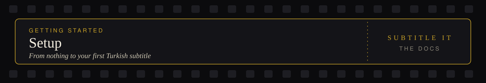
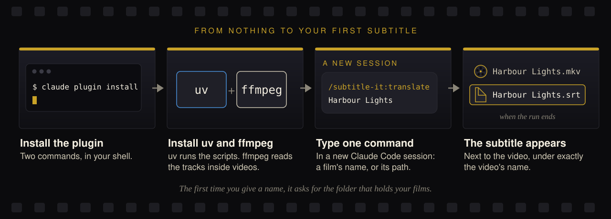
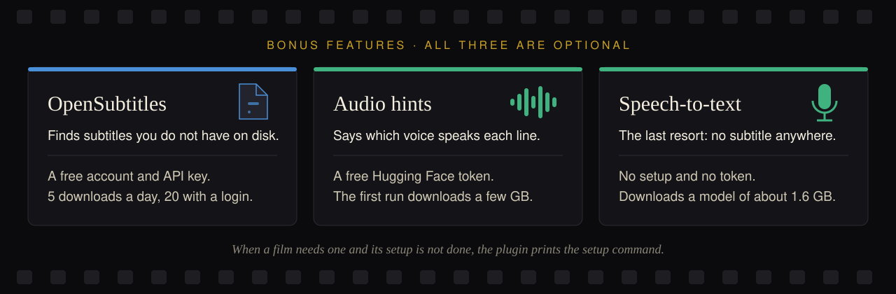

# Setup



> **This document owns:** what you need, how to install the plugin, the
> first run, the three optional extras, and what to do when a step fails.

Read this if you have never run the plugin. Installing it and running
one command is enough to start. A run prints a setup command the first
time it needs one of the extras.



## Prerequisites

| You need | Why |
| --- | --- |
| [Claude Code](https://code.claude.com/docs) | The plugin runs inside it |
| uv | Runs the scripts and installs their packages on first use |
| ffmpeg and ffprobe, on PATH | Read the subtitle tracks inside videos |
| Subtitles in a text format | SRT, ASS, WebVTT, or a text track inside the video |

Image subtitles (PGS, VobSub) are not read.

## Install

1. **Install the plugin** in your shell:

   ```
   claude plugin marketplace add specialone0007/subtitle-it
   claude plugin install subtitle-it@subtitle-it
   ```

2. **Install uv:**
   - Windows: `winget install astral-sh.uv`
   - macOS and Linux: `curl -LsSf https://astral.sh/uv/install.sh | sh`

3. **Install ffmpeg and ffprobe:**
   - Windows: `winget install Gyan.FFmpeg`
   - macOS: `brew install ffmpeg`
   - Debian and Ubuntu: `sudo apt install ffmpeg`

## Run it

Start a **new** Claude Code session and type the command with a film's
name or the path to its video:

```
/subtitle-it:translate Harbour Lights
```

Plain `/translate` also works when no other command uses that name.

The first time you give a name, it asks for the folder that holds your
films and saves it in your preferences.

## First success

When the run ends, `Harbour Lights.srt` sits next to
`Harbour Lights.mkv`, on the source file's own timings.
It has exactly the video's name, so a TV playing the film from a USB
stick picks it up. [Numbers](../reference/NUMBERS.md#run-time) says how
long a run takes.

## The three extras



All three are optional. When a film needs one and its setup is not done,
the plugin prints the setup command for you to run in your own terminal.

### OpenSubtitles

**For films without subtitles on disk, and to look for a human-made
Turkish subtitle to polish.** Get a free API key, then run
the setup command the plugin prints. From a clone of this repo it is:

```
uv run scripts/opensubtitles.py setup --config ~/.config/subtitle-it
```

<details>
<summary><b>The key and the daily limits</b></summary>

1. Create a free account and a free API key at
   <https://www.opensubtitles.com/consumers>.
2. Run the setup command above.

It asks for the key and the login without showing them. A key alone
allows 5 downloads a day, and with the account login 20. Downloads are
cached.

</details>

### Audio hints

**Tells the translators which voice speaks each line.** Get a free
Hugging Face token, then run the setup command the plugin prints. From a
clone it is:

```
uv run scripts/speakers.py setup --config ~/.config/subtitle-it
```

<details>
<summary><b>The token, the model terms and the first download</b></summary>

1. Create a free read token at <https://huggingface.co/settings/tokens>.
2. With the same account, accept the terms of
   <https://huggingface.co/pyannote/speaker-diarization-3.1> and
   <https://huggingface.co/pyannote/segmentation-3.0>.
3. Run the setup command above.

It asks for the token without showing it. The first run downloads a few
GB: PyTorch, pyannote and a Whisper model.

</details>

When the subtitles are out of sync with the audio, this step moves them
to match and says so in the report.

### Speech-to-text

**The last resort, when no subtitle file exists anywhere.** It needs no
setup and no token. Its first use downloads a Whisper model of about
1.6 GB, plus PyTorch unless the audio hints already did.

### How long the extras take

| Machine | Audio hints | Speech-to-text |
| --- | --- | --- |
| With an NVIDIA GPU | A few minutes per film | A few minutes per film |
| CPU only | About as long as the film | About as long as the film, or more |

## Platforms

Full runs have only been tested on Windows. On macOS and Linux, CI runs
the test suite, including one test that builds a short video and reads
its subtitle track with the real ffmpeg. A full run there is untested.

## If it fails

Most fixes are a new session, or the setup command the plugin printed.

<details>
<summary><b>When a step fails</b></summary>

| What you see | What to do |
| --- | --- |
| The command is not found right after installing | Start a new session. Claude Code loads plugins when a session starts |
| uv or ffprobe is reported missing | Install it as above, then start a new session |
| "No OpenSubtitles credentials" | Run the setup command it printed, in your own terminal |
| Audio hints are skipped with "token missing" | Run the command it printed. The run goes on without voices |
| The film is not found, and a folder is named as missing | Reconnect that drive, or give the path to the video |
| Several films match the name | Answer which one. It is the only question a run asks |

</details>

Never type a key, a password or a token into the chat. The setup
commands ask for them in your terminal.

---

Next: [After a run](../guides/AFTER_A_RUN.md) ·
[Preferences](../reference/CONFIGURATION.md) · [All docs](../INDEX.md)
