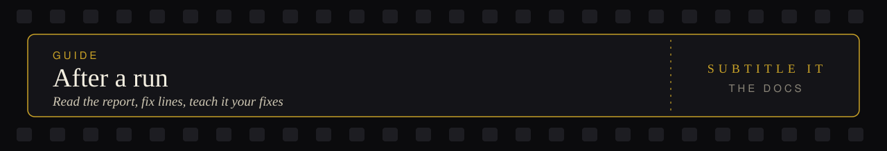
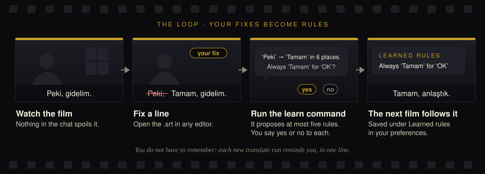

# After a run



> **This document owns:** what to do once a subtitle is delivered: read
> the report, fix lines, and teach the plugin your fixes.

Read this if a run just finished and you are about to watch the film, or
you have watched it and changed some lines.



## 1. Watch the film

The subtitle is `<film>.srt`, next to the video. Nothing in the chat
discusses the plot, so nothing is spoiled.

## 2. Read "Check after watching"

Each run writes `report.md` in the film's work folder. Open it after
the film, since it quotes lines.


"Check after watching" is the last section. It lists what the run could
not settle for certain, each with a timestamp.

<details>
<summary><b>What the list can hold</b></summary>

- a decision about the film that was settled by a safe default
- in a polish run, a crude line that stayed softer than the English
- a cue that still failed a check after the fix rounds
- a translator's flag the reviewers left open
- the goodbye's time, when the picture showed no end cards
- three timestamps to spot-check in a player, when the timing is not
  certain
- when the text was written from the audio: a note that names and quiet
  or overlapping lines may be misheard, and the cues flagged as such

</details>

Two more sections are for the curious: on-screen text, and time and
usage.

<details>
<summary><b>What those two sections tell you</b></summary>

| Section | Tells you |
| --- | --- |
| On-screen text | Which title cards and signs were added, and which were left out and why. In a polish run, also the human file's lines that sit under no on-screen cue |
| Time and usage | How long each step took, and how many tokens each kind of agent used |

</details>

## 3. Fix lines

Open `<film>.srt` in any editor and change the lines you did not like.

The file that was there before, if any, is in the `backups/` folder of
your settings folder.

## 4. Teach it your fixes

Run learn mode with the film's name:

```
/subtitle-it:learn Harbour Lights
```

It proposes rules from the fixes you made more than once, and saves only
the ones you say yes to.

<details>
<summary><b>What learn mode does, step by step</b></summary>

1. It compares your edited file with the one it delivered.
2. It proposes at most five general rules, each with a count and one
   example: "You changed 'Peki' to 'Tamam' in 6 places. Always use
   'Tamam' for 'OK'?"
3. You say yes or no to each.
4. The ones you accept are saved under "Learned rules" in your
   preferences. Every later run follows them.

It skips one-off fixes, rules you already have, and rules the Turkish
language pack already sets.

</details>

You do not have to remember to do this. Each new translate run checks
for delivered files you have edited, and reminds you in one line.

## 5. Change how runs behave

A rule you want without editing a film first goes straight into
`preferences.md`. So do the settings for songs, sound descriptions and
the credit. [Preferences](../reference/CONFIGURATION.md) lists them all.

---

Previous: [Setup](../getting-started/SETUP.md) · Next:
[How a run works](../reference/ARCHITECTURE.md) ·
[All docs](../INDEX.md)
