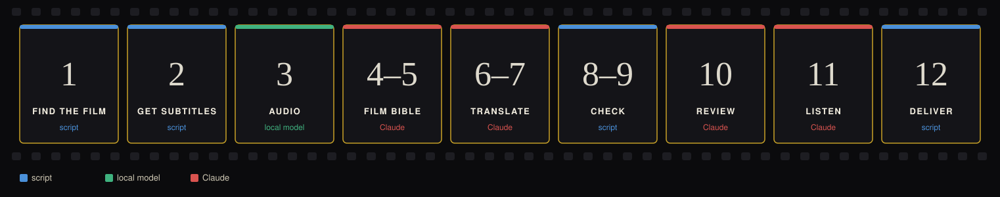
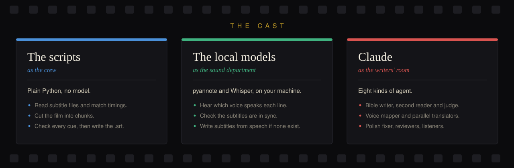
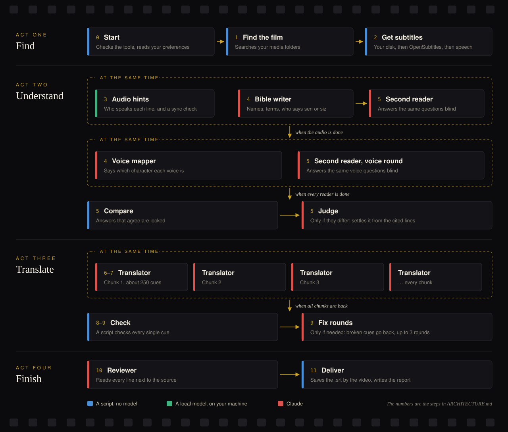

# How a run works

> **This document owns:** the map of a run: who does what, the four acts,
> the steps in one line each, and what each script and agent is for.

Read this if you want to know what happens between the command and the
`.srt`. Each act links to a page with its exact rules.

## The one rule

Anything with one right answer is a script. Anything that needs a feel
for language is an agent.

<b>Who does what, and what follows from the split</b>

| Who | Does | Lives in |
| --- | --- | --- |
| **Scripts** | Read subtitle files, match timings, cut chunks, check every cue, write the file, time the run | `scripts/` |
| **Local models** | Hear who speaks when (pyannote), check the sync and write subtitles from speech (Whisper) | Your machine |
| **Agents** | Write the film bible, translate, review, listen, read the picture | `agents/` |

Three things follow from that split:

- **Scripts are tested.** Each one is plain Python and prints a JSON result.
- **Agents get paths, not text.** Each agent reads its own files, writes its
  own files and replies with a short summary.
- **The main conversation never reads a whole subtitle file.** It reads the
  scripts' results, the bible and the review, so a full film fits in one
  session.

## The whole run on one page

Read it top to bottom. A dashed gold frame means the boxes inside it run
at the same time. The numbers are the steps below, and they match
`skills/translate/SKILL.md`, the skill Claude follows for
`/subtitle-it:translate`.

The one-time setup steps live in `setup.md` beside that skill. A run
reads them only when a step needs them.

## Act 1: Find

The run finds the video, gets subtitles to translate from, and makes sure
their timing fits this exact video.

<b>The steps, one line each</b>

| Step | What happens | Done by |
| --- | --- | --- |
| 0. Start | Checks the tools, finds your settings, reads your preferences | skill, script |
| 1. Find the film | Searches your media folders for the name you gave | script |
| 2. Source subtitles | Takes subtitles from disk, OpenSubtitles or the film's speech, then settles the timings | script, local model |
| 2. On-screen text | Finds title cards and signs in other subtitle tracks and in the picture | script, agent |

Exact rules: [Act 1: Find](run/ACT_1_FIND.md) and
[On-screen text](ON_SCREEN_TEXT.md).

## Act 2: Understand

Before anyone translates a line, the film's decisions are written down
once and checked by a reader who never saw them.

<b>The steps, one line each</b>

| Step | What happens | Done by |
| --- | --- | --- |
| 3. Speaker hints | Finds which voice speaks each line and checks the sync. Optional | local model |
| 4. Film bible | Writes the characters, the terms and who says *sen* or *siz* to whom | agent |
| 5. Check the bible | A second reader answers the same questions blind, and a judge settles the rest | agents, script |

Exact rules: [Act 2: Understand](run/ACT_2_UNDERSTAND.md).

## Act 3: Translate

Every chunk is translated at the same time, then a script checks every
cue.

<b>The steps, one line each</b>

| Step | What happens | Done by |
| --- | --- | --- |
| 6–7. Translate | One translator per chunk, all started at once | agents |
| 8–9. Assemble and check | Joins the chunks, checks every cue, lays out every line | script |

Exact rules: [Act 3: Translate](run/ACT_3_TRANSLATE.md) and
[Checks](CHECKS.md).

## Act 4: Finish

The translation is read twice, in two different ways, and then delivered.

<b>The steps, one line each</b>

| Step | What happens | Done by |
| --- | --- | --- |
| 10. Review | Each part is compared line by line with its source | agents |
| 11. Listen | The finished Turkish is read alone, the way a viewer reads it | agents, script |
| 12. Deliver | Writes `<film>.srt` next to the video and a report | script |

Exact rules: [Act 4: Finish](run/ACT_4_FINISH.md).

## Two kinds of run

A human file is used when it lines up with the video and covers most of
the spoken lines.
[Act 1](run/ACT_1_FIND.md#an-existing-turkish-subtitle) has the exact
rule.

<b>The two runs side by side</b>

| | Translate run | Polish run |
| --- | --- | --- |
| **When** | No usable Turkish subtitle exists | A human-made Turkish subtitle fits the video |
| **Starts from** | The source subtitles | The human file, placed on the timing file's cues |
| **Language work** | Translators, then reviewers and listeners | One polish fixer, reviewers at the same time, then listeners |

## The scripts

One script per job, from finding the film to timing the run. Each saves
its result to a file, and the skill reads that file.

<b>Every script and what it is for</b>

| Script | What it is for |
| --- | --- |
| `sources.py` | Find films, extract subtitle tracks, validate sources |
| `opensubtitles.py` | OpenSubtitles login, search and download |
| `srt.py` | Parse subtitle files, handle encodings, pair files by time, cut chunks |
| `transcribe.py` | Check the timing file against the speech; write subtitles from audio as the last resort |
| `speakers.py` | Find the voice of each cue from the audio; check the sync |
| `screen.py` | Read the picture with ffmpeg: frames for on-screen text, the cut to black |
| `prepare.py` | Build the work folder and the chunks |
| `bible.py` | Questions, blind comparison and judging for the film bible; adds the voices |
| `polish.py` | Start from a human Turkish subtitle: place it, list the cues to fix |
| `assemble.py` | Join, check, cut review and listen parts, deliver |
| `layout.py` | Lay out each cue as it is shown: lines, splits, time on screen |
| `turkish.py` | Turkish rules as code: where a line may break, spelling, name suffixes |
| `learn.py` | Find the lines you edited, for learn mode |
| `compare.py` | Blind side-by-side comparison of two or three delivered files |
| `usage.py` | Record the run's time per step and each agent's tokens |
| `settings.py` | Find the settings folder |
| `result.py` | Print each script's JSON result and save it |

The skill reads each script's saved result file, not its printed output.
A shell or tool that shortens command output therefore does not get in
the way.

## The agents

Each agent runs as its own agent type. Its file holds its instructions
and the few tools it may use. It leaves out the general Claude Code
instructions and your `CLAUDE.md` files, which it does not need.

<b>Every agent, its step and what it does</b>

| Agent | Step | What it does |
| --- | --- | --- |
| Screen reader | 2 | Reads the text shown in frames from the video |
| Bible writer | 4 | Reads the film once and writes the film bible |
| Voice mapper | 4 | Decides which character each voice is |
| Second reader | 5 | Answers the bible's questions without seeing the bible |
| Bible judge | 5 | Settles the questions the two readers disagree on |
| Translator | 6–7, 9, 10 | Translates one chunk; fixes cues that fail a check |
| Polish fixer | 6–7, 10 | Fixes the flagged cues of a human Turkish file |
| Reviewer | 10, 11 | Compares one part with its source; checks the listener's edits |
| Listener | 11 | Reads the Turkish as a viewer and fixes lines that sound translated |

## Learn mode

`/subtitle-it:learn <film>` is a separate skill, so a translate run does
not carry its steps. It reads the language pack and the preferences
template from `skills/translate/` instead of keeping copies.
[After a run](../guides/AFTER_A_RUN.md) shows how to use it.

## Where things are kept

- **Next to the video:** only `<film>.srt`.
- **Your settings folder:** preferences, credentials and backups.
- **The plugin's data folder:** one work folder per film, the download
  cache and the scripts' results.

[Files and privacy](PRIVACY.md) has the paths and what each folder holds.

---

Next: [Act 1: Find](run/ACT_1_FIND.md) · [All docs](../INDEX.md)
