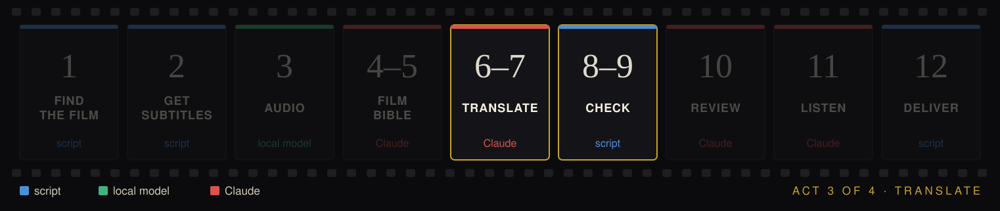

# Checks

> **This document owns:** every check `assemble.py check` runs on the
> translated cues: the hard fails, the warnings, and the exceptions each
> one allows.

Read this if a report or a review names a check and you want to know
what it means. The check runs in steps 8–9, and again after every round
of fixes.

- A **hard fail** goes back to the translator, for up to three fix
  rounds. A cue that still fails is delivered as it is, and the report
  lists it under "Check after watching".
- A **warning** goes to the reviewers, who decide with the scene in front
  of them.

## Hard fails

A hard fail is a cue the script can show is broken. One is missing, its
italics or dashes differ from the source, it does not fit two lines, or
it holds something that is not the line.

<b>Every hard fail</b>

| Check | Fails when |
| --- | --- |
| Missing, extra or empty cue | The Turkish has a cue the source lacks, lacks one, or leaves one empty |
| `italic tags` | Italics differ from the source |
| `dialogue dashes` | The dashes that mark two speakers differ from the source |
| Layout | The cue cannot be laid out in two lines of 42 characters |
| Square brackets | With hearing-impaired tags on `remove` (the default), the Turkish holds `[` or `]` |
| Speaker label or description | The Turkish holds a label or a parenthesis where the source cue had tags removed |
| `line-join slash` | The Turkish holds a ` / ` that the source and English lines lack |
| Only a sound description | With tags on `remove`, the cue has no words left once labels and descriptions are taken out |
| `on-screen text` | On-screen text the build added as a cue has no cue that is delivered |
| `file format` | An output file is malformed, so its cues cannot be read |

The slash comes from the agents' listings, which join a cue's lines with
` / `. Copied back, it means a line break.

Two warnings sit beside these: `left-out cue` and `sound-only cue`. Each
means the Turkish has text for a cue the build left out, or for one that
holds only sounds. That text is rejected and never delivered.

### What the hard fails allow

Three cases differ from the source on purpose, and pass: a song in
italics, italics left off a single word, and a dash that carries a
sentence on.

<b>The three exceptions</b>

| Case | Why it passes |
| --- | --- |
| A song cue in italics where the source is plain | The language pack puts songs in italics. A cue is a song when the build marked it, or when any source track shows `♪` or `♫` on it |
| Italics on a single word left out: `<i>To</i> all the harbour crews` | Such italics are mostly a slip in the source file. Keeping them only gives a `stray italics` warning |
| A `- ` that carries a sentence on | The cue before it ends with ` -` and the words go on in lower case. Danish, Norwegian and Swedish files do this. A polish run drops that dash from a seeded Turkish cue too |

A cut-off word (`I was-`) and an interruption followed by a new speaker
in a capital keep their dash check.

## Warnings about reading

Meaning and natural Turkish come first. A reviewer reaches 17 only by a
shorter natural wording or by dropping filler. Otherwise the line stays,
fast.

| Check | Warns when |
| --- | --- |
| Reading speed | A cue reads above 17 characters a second, even when the source is as fast |
| `only the Turkish is fast` | The same, and the source reads at 17 or less |
| `ve opening` | A line opens with "Ve" |
| `stray italics` | The Turkish keeps italics on a single word beside plain ones |
| `infinitive command` | A one-line cue is a bare infinitive, such as "Durmak." |
| `caps` | A line writes "TAMAM" or "HAYIR" in capitals |

Both speeds are measured over the time the cue is shown. For a fast cue
that can run into the silence after it.

## Warnings about spelling

Three kinds of slip that a script can spot.

| Check | Example |
| --- | --- |
| A missing circumflex | A plain "hala" or "aşık" that probably needs one |
| A spelling slip against the Turkish Language Association (TDK) | "sağol" for "sağ ol" |
| A name suffix that does not fit how the name sounds | "Casey'in" for "Casey'nin" |

## Warnings about consistency

These keep the film in one voice: one word for a term, one wording for a
line said twice, and the bible's *sen* or *siz* for each pair.

<b>Every consistency warning</b>

| Check | Warns when |
| --- | --- |
| Glossary variant | A glossary term is written another way |
| `term rendering` | The source says a term the bible decided, and the Turkish lacks a word of the bible's rendering |
| `term drift` | A second form of a word the rest of the film writes one way: "ağabey" among "abi" |
| `repeat drift` | A line the film says again in the same words is written two ways in Turkish |
| `bible repeat` | The same, for a line the bible says is said word for word |
| `split sentence` | A sentence that runs over several cues is broken badly |
| *Sen* or *siz* | A line uses another form than the bible gives for that pair |
| `address changed` | In a polish run, a fix changes the human file's *sen* or *siz* and gives no reason |

### Term rendering

Any ending passes, and so does a singular for a plural. A different word
does not: "Liman Meclisi Başkanı" is not "Liman Kurulu Başkanı".

<b>Where the check takes its rules from</b>

The check takes its rules from three places in the bible:

- the term decisions
- the name decisions, on the cues they cite. The rank "Deputy" there is
  not "her deputy" in another scene
- the `"term" → "rendering"` lines of the World, Glossary and Titles
  sections that no decision covers. A line that names cues in parentheses
  applies to those cues only

Two details keep it fair:

- A term's senses count together: "bridge" and "the bridge".
- A family word such as "brother" takes every word the bible gives it:
  "abi" for one pair, "kardeş" for another.

So a pair's decision is never flagged against a generic entry.
`bible.py apply` lists such generic entries as `term_conflicts`.

### Repeated lines

`repeat drift` is for a chant, a saying or a callback. It quotes the
other wording, since the two cues often sit in different review parts.

<b>Stock phrases, and when it becomes a bible repeat</b>

- The cue it is told to match gets a `repeat match` note, so its own
  reviewer keeps that wording.
- The check cannot tell a callback from a stock phrase anyone says, such
  as "Come on!". The reviewer can, and words a stock phrase for its scene.

The warning becomes `bible repeat` when both cues sit in one group the
bible marks with "identical", "word for word", "same words" or "both
times". Each item between semicolons on such a line is one group, made
of the cue numbers it names.

### Split sentences

`split sentence` looks at each run of cues whose source sentence goes on
without a full stop. It warns when the Turkish:

- writes a part twice
- leaves a cue with nothing of its own
- puts a name in another cue than the one that says it

### Sen and siz

The check compares each line with the bible's form for the pair. The
reviewers still read every cue's *sen* or *siz*.

<b>When the check stays silent</b>

It stays silent in these cases, where the speaker or the listener may be
the wrong one:

- a question and its answer heard as one voice
- a name spoken about someone, not to them
- a form the other side of the pair uses back, while the audio gave the
  cue next to it the same voice and that other person is in the scene
- a speaker's own slip into the other side's form, on two cues in a row
- a cue two people speak in, where the speaker is not known
- *siz* where the bible gives *sen* and the line names nobody, since
  *siz* is also the plural you

When a speaker uses different forms to different people and the line
names nobody, the listener is taken to be the one other character
speaking right before or after, in the same scene.

---

Related: [Act 3: Translate](run/ACT_3_TRANSLATE.md) ·
[Act 4: Finish](run/ACT_4_FINISH.md) · [All docs](../INDEX.md)
