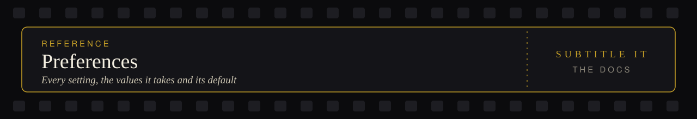
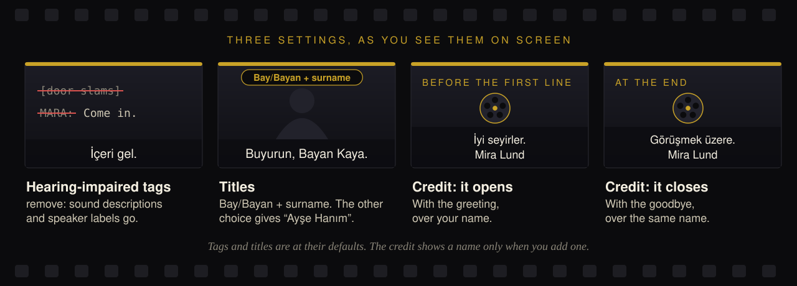

# Preferences

> **This document owns:** every setting in `preferences.md`: what it
> does, the values it takes and its default.

Read this if you want a run to behave differently: keep sound
descriptions, translate every song, change the credit or pick another
model.

## The file

`preferences.md` lives in your settings folder:

- macOS and Linux: `~/.config/subtitle-it/preferences.md`
- Windows: `C:\Users\<you>\.config\subtitle-it\preferences.md`

It is created on the first run from a template. The skill reads it at
the start of every run, so you can edit it freely with any editor. Each
setting is a heading with its value on the line below.

## Settings

The call sheet above shows every setting at its default. Here is what
three of them look like on screen:

<b>Every setting, with the values it takes</b>

| Setting | Values | Default | What it changes |
| --- | --- | --- | --- |
| Media folders | One folder per line | Asked on the first run | Where a film is searched when you give a name, not a path |
| Translator model | `session`, `sonnet`, `opus`, `haiku`, `fable` | `session` | The model the translators run on. `session` is the model of your conversation |
| Audio hints | `yes`, `no`, `auto` | `auto` | Whether voices are found from the film's audio. `auto` runs them when an NVIDIA GPU is found |
| Hearing-impaired tags | `remove`, `keep` | `remove` | Whether sound descriptions and speaker labels are taken out |
| Songs | `story`, `skip`, `all` | `story` | Which song lyrics are translated |
| Swearing | `match the source`, `one step softer` | `match the source` | How strong the swearing is in Turkish |
| Titles | `Bay/Bayan + surname`, `first name + Bey/Hanım` | `Bay/Bayan + surname` | How people are addressed by title: "Bayan Kaya" or "Ayşe Hanım" |
| Credit | `on` or `off`, then a name on the next line | `on` | The two credit lines added to the delivered file |
| Learned rules | Added by learn mode | Empty | Rules from your own fixes, used by every later run |

## Notes on four settings

### Audio hints

Audio hints need a free Hugging Face token.
[Setup](../getting-started/SETUP.md#audio-hints) shows how to add it.
Without an NVIDIA GPU they take about as long as the film.

### Hearing-impaired tags

`remove` takes sound descriptions (`[door slams]`) and speaker labels
(`MARA:`, `[Mara]`) out of the text and of the Turkish. It also
leaves out cues that are only sounds.

<b>Which brackets and labels go</b>

Square brackets go from every file. Parentheses and labels in capitals
go only from a file that is hearing-impaired.
[Act 1](run/ACT_1_FIND.md#what-is-taken-out-of-the-text) has the exact
rules.

### Songs

`story` translates only the songs that carry the story: sung by a
character on screen, or lyrics that speak to the scene. That is what the
Netflix Turkish style guide does.

### Credit

With the credit on, the delivered file opens with "İyi seyirler." and
closes with "Görüşmek üzere.", each over your name.

<b>The name and the opening line: the exact rules</b>

- The name goes on the line below `on`. It can be 42 characters at most.
- With no name, the greeting shows alone.
- The opening line is shorter or left out when the film speaks in its
  first 7.5 seconds.

[Act 4](run/ACT_4_FINISH.md#where-the-goodbye-starts) explains where the
closing line is placed.

## Learned rules

Learn mode adds rules at the bottom of the file, and only after you say
yes to each one. You can also write or delete rules there by hand.
[After a run](../guides/AFTER_A_RUN.md) shows the whole loop.

## Credentials are not preferences

Your OpenSubtitles login and Hugging Face token are kept in
`credentials.json` beside the preferences. You type them into a setup
command in your own terminal, never into this file and never into the
chat. [Files and privacy](PRIVACY.md) says who receives them.

---

Related: [Setup](../getting-started/SETUP.md) ·
[Files and privacy](PRIVACY.md) · [All docs](../INDEX.md)
