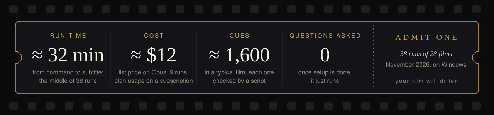
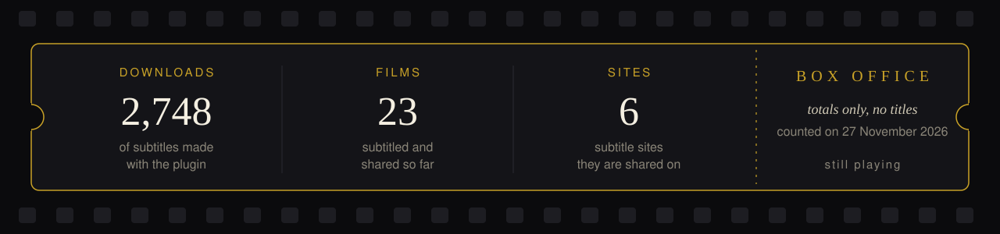

# Numbers

> **This document owns:** every measured figure, with what was measured
> and when: run time, tokens, cost and downloads.

Read this if you want to know what a run takes before you start one, or
you are about to quote a figure. No film is named, on purpose.

The run figures live here and nowhere else, apart from the two pictures
in the README. A measurement that explains one rule stays beside that
rule.

## The short version

| Figure | Value | Measured on |
| --- | --- | --- |
| A run, from the command to the subtitle | About 32 minutes | 38 runs of 28 films |
| Cost at API list prices | About $12 | 9 of those runs, on Claude Opus 5.5 |
| Cues in a film | About 1,600 | The 28 films |
| Questions asked during a run | 0 | By design. The one exception is a name that matches several films |
| Downloads of subtitles made with the plugin | 2,748 | 23 films on 6 sites |

"About" always means the median: half the runs were below it and half
above.

## What was measured

The run figures come from runs on one Windows PC, over two weeks of
November 2026.

<b>The runs behind the figures</b>

| Fact | Value |
| --- | --- |
| Runs | 38, each with its own saved timings |
| Films | 28. Six were run more than once, as tests |
| Dates | 13 to 26 November 2026 |
| Machine | One Windows PC |
| Film length | Median 107 minutes, from 72 to 249 |
| Cues per film | Median 1,588, from 423 to 3,415 |
| Kind of run | 31 polished a human Turkish subtitle, 7 translated from scratch |

The plugin changed during those two weeks. Later versions read the
picture and add a listen pass, so later runs do more work.

## Run time

Time is clock time from the first step to the last. It includes waiting
for downloads.

| Runs | Count | Median | Middle half |
| --- | --- | --- | --- |
| All | 38 | 32 minutes | 25 to 39 |
| Translate from scratch | 7 | 27 minutes | 25 to 34 |
| Polish a human subtitle | 31 | 33 minutes | 25 to 40 |

The shortest run took 12 minutes. The longest took 217, because clock
time also counts any time a session sat waiting.

### Where the time goes

<b>The same figures as a table, and how to read them</b>

| Steps | What happens | Median |
| --- | --- | --- |
| 0–2 | Find the film and its subtitles | 7 minutes |
| 3–5 | Audio hints, the film bible and its check | 11 minutes |
| 6–7 | Translate from scratch | 4 minutes |
| 6–7 | Or polish a human subtitle | 11 minutes |
| 8–9 | Assemble and check | Under a minute |
| 10 | Review against the source | About a minute |
| 11 | Listen pass | 3 minutes |
| 12 | Deliver and write the report | Under a minute |

Steps 0–2 vary the most: a quarter of the runs needed about a minute,
and a quarter needed more than 10. The runs do not record whether the
audio step used a graphics card.

These are stretches of the clock, not the agents' own work. Agents run
side by side, so the reviewers of a run add up to about 14 minutes of
work inside a review step that takes about one.

## Tokens

A token is the unit a Claude plan or bill counts. Token use was counted
from the saved sessions of 9 runs.

| Kind of token | Median per run | Middle half |
| --- | --- | --- |
| Read back from the cache | 11.0 million | 10.3 to 14.4 million |
| Written to the cache | 0.93 million | 0.77 to 1.10 million |
| Written by Claude | 0.22 million | 0.21 to 0.30 million |
| Other input | Under 500 tokens | |

Cached reads are text Claude has already seen in the session. They are
the cheapest kind, and a run is mostly made of them.

<b>Why only 9 runs were counted</b>

| Of the 38 runs | Count |
| --- | --- |
| Counted | 9: 8 polish runs and 1 translate run |
| No saved session left on the machine | 22 |
| The session also held other work or other runs | 7 |

### Who uses them

Shares are of the run's tokens, weighted roughly by price, as medians
over the 9 runs.

| Part of the run | Share |
| --- | --- |
| The main conversation | 26% |
| Reviewers | 25% |
| Polish fixers, in a polish run | 14% |
| Second readers | 8% |
| Bible writer | 8% |

<b>How the shares are weighted, and why a report shows less</b>

The weights are fixed, and are not the exact list prices: 1 for other
input, 1.25 for a cache write, 0.1 for a cache read, 5 for output. A
cache read counts 0.1 here and 0.05 at the list price, so parts that
mostly re-read get a larger share here than of the cost.

A run's own `report.md` shows less than this. It records each agent's
size when the agent finished, not everything the agent read along the
way, and it leaves out the main conversation. The measured total for the
agents was about 7 times the report's figure.

## Cost

Cost is the token counts above at API list prices. Nobody paid these
amounts: the runs used a Claude subscription, where a run uses plan
usage instead.

| Runs | Count | Median | Middle half | Range |
| --- | --- | --- | --- | --- |
| Measured runs | 9 | $12 | $10 to $14 | $7 to $19 |

<b>The model and the prices used</b>

Every part of every measured run used Claude Opus 5.5. The prices, in
dollars per million tokens, were read from
[Anthropic's price list](https://platform.claude.com/docs/en/about-claude/pricing)
on 28 November 2026:

| Other input | Cache write, 5 minutes | Cache write, 1 hour | Cache read | Output |
| --- | --- | --- | --- | --- |
| $4 | $5 | $8 | $0.20 | $20 |

### Why a run today likely costs more

The 9 measured runs are from 13 to 20 November and started a median of
10 agents each. Runs since 20 November start a median of 24. Later
versions also read the picture and add a listen pass.

One run from 26 November could be counted only roughly. It started 32
agents and came to about $29. Treat that as one data point, not a
typical figure.

## Downloads

Subtitles made with the plugin are shared on public subtitle sites.
These are the sites' own download counters, read on 27 November 2026.

| Figure | Value |
| --- | --- |
| Downloads of subtitles that are live | 2,748 |
| Films | 23 |
| Sites | 6 |

The totals name no film, no site and no uploader, to protect the
subtitles. Subtitles a site has removed are not counted.

## What these numbers cannot tell you

They come from one Windows PC and a small set of films, and the cost
figures from one model. Your run will differ.

<b>The five limits</b>

- **Your machine.** Every run was on one Windows PC. A full run on macOS
  or Linux is untested; CI runs only the test suite there.
- **Your film.** A longer film has more cues and starts more agents.
- **Your model.** The token and cost figures are for Claude Opus 5.5,
  and the model was not recorded for the other 29 runs. Another model
  changes the time, the tokens and the price.
- **Translate runs.** Only 1 of the 9 runs measured for cost translated
  from scratch.
- **Repeats.** One film alone accounts for 5 of the 38 runs, and for 3 of
  the 9 measured for cost.

Each run saves its own time per step in the film's `report.md`, and in
`usage.json` in the work folder.

---

Related: [How a run works](ARCHITECTURE.md) ·
[Files and privacy](PRIVACY.md) · [All docs](../INDEX.md)
