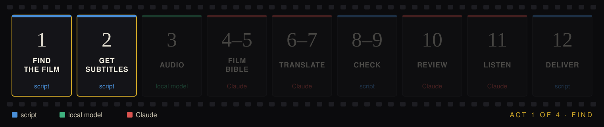
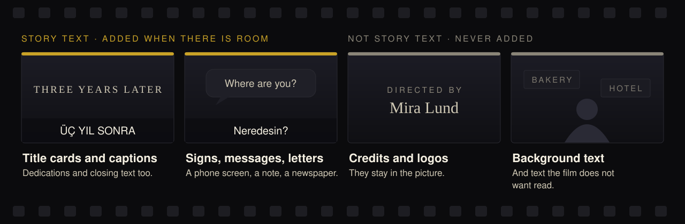

# On-screen text

> **This document owns:** how a run finds title cards, captions and signs
> that the timing file leaves to the picture, and the rules that
> decide which of them become subtitles.

Read this if a card was added that should not be, or one is missing. It
is part of step 2. The run looks in two places: the film's other subtitle
tracks, and the picture itself.

Every text found becomes one row of `on_screen.json` in the work folder.
A row is either added as a cue of its own, marked `on_screen`, or left
out with a reason. The list is written afresh on every build, so with no
other track it is empty and no earlier run's rows survive.

## From the other subtitle tracks

`prepare.py build` reads the film's other tracks (`--track`,
`--forced-track`). It looks for lines they show where the timing file
shows nothing.

**When a line is added**

| Other languages that fit | A line is added when |
| --- | --- |
| Fewer than 6 | Two languages show it, or a forced track shows it |
| 6 or more | Three quarters of them show it, or a forced track shows it |

<b>Why the rule is stricter with many languages</b>

The stricter rule exists because some tracks also subtitle shop signs in
the background. In one test film with 31 other languages, the story texts
were shown by 27 to 31 of them and the background signs by 5 to 21.

The timing file's own language and tracks marked `und` do not count as
other languages.

**Why a line is left out**

The usual reasons: too few tracks show it, it has no room, or it is a
credit or a song lyric. Each row left out carries its reason.

<b>Every reason, and three more rules</b>

| Reason | Meaning |
| --- | --- |
| one language only | A single track shows it. A French track also subtitles shouts |
| too few languages | With 6 or more languages, fewer than three quarters show it |
| no room | It falls between two lines with no space |
| subtitle credit | It is a translator's credit, not the film's text |
| song line | It is a lyric marked with `#` |
| during a song or a sound | Two languages show a sign while a song or a sound plays. It is recorded, not added |

- With 6 or more languages, a line shown at the same time as another
  track's subtitle credit is left out with it. A credit reads as one in
  some languages only. With fewer languages, credits are grouped apart.
- A line the timing file already covers is the film's own line. It is
  only counted.
- An on-screen cue is never marked as a song or a sound, and the check
  fails when one is left out of the translation.

## From the picture

This part runs for a video input. A `.srt` input has no picture.

### 1. Make sure there is a second language

With fewer than two other languages, the run tries to download one more
subtitle track.

<b>The exact rules</b>

`sources.py others` counts the other languages among the usable full
tracks. Turkish, `und`, forced tracks and the timing file's own language
are left out, and `pt` and `pt-br` count as one.

With fewer than two, the skill makes one OpenSubtitles search and one
download, French then Spanish. The file is added as one more track when
it validates. Any failure skips it.

### 2. Save frames

`screen.py frames` saves still pictures with ffmpeg.

| Setting | Value |
| --- | --- |
| Size | 960x540 at most, HDR tone-mapped when ffmpeg has zscale |
| The opening | One frame every 1.5 s, from the start to the first spoken line, 2.5 minutes at most |
| The ending | One frame every 1.5 s, for 2.5 minutes from the story's end |
| Each unsure text in between | 5 frames across its time, widened by 2 s on each side |
| Most frames per film | 300 |

<b>Which texts are unsure, and what happens over 300 frames</b>

A text is **unsure** when it was left out as too few languages, or when
exactly one other language exists and only it shows the text.

Over 300 frames, the unsure frames are thinned first, down to one each.
Then the latest are dropped. The opening and the ending are never
thinned.

`screen/frames.json` in the work folder lists each frame with its time,
why it was picked, and the rows within 3 s of it.

### 3. Skip frames that cannot add anything

A dark frame and a frame that repeats an earlier one do not go to a
reader.

<b>The exact rules</b>

| Frame | Rule | What it gets |
| --- | --- | --- |
| Dark | No pixel brighter than grey 20 of 255 | No text |
| Repeat | Every tile of a 96x54 grid is within 4 grey levels of the frame that opened its run | That frame's reading |

Neither goes to a reader. One changed digit on a card ("2020", "2021")
moves a tile far more than 4 levels, so it is not a repeat. On one film
this sent 241 of 300 frames, with the same readings.

The dark rule is stricter than the cut to black that places the goodbye,
so a frame with a faint title is still read.

### 4. Read the frames

Screen reader agents read the frames and write one line for each.

<b>What a reader writes, and how many frames it gets</b>

| Setting | Value |
| --- | --- |
| Frames per screen reader agent | 40 |
| Frames per batch file | 20 |

Each reader writes one line per frame:

- the text, word for word
- its kind: title card, caption, sign, text message, letter, dedication,
  closing text, credits, logo or background
- whether the film wants it read
- the rows of `on_screen.json` it shows, if any. There are several when
  a track split one card into two lines

### 5. Join the readings

`screen.py collect` checks there is one line per frame sent, and sends
missing ones back once. It joins neighbouring frames with the same text
into one reading.

<b>What counts as the same text</b>

- Case and punctuation do not count: "Dad's / shop" and "dad's shop"
  are one text.
- Two story kinds, such as a sign read as a caption, are one kind.
- A reading takes the text and kind that most of its frames give.

### 6. Decide

`prepare.py build --screen` then decides. A reading joins a row only when
it names that row.

Credits, logos, background text and text the film does not want read are
never added. A row left out for no room, or during a song or a sound,
stays out. A line that enough other tracks show is still added, whatever
the picture's reader said.

<b>Every case</b>

| Case | Result |
| --- | --- |
| An unsure row that a story reading names | Added |
| An unsure row whose frames were all read and never named it | Left out: `not confirmed by the picture` |
| An unsure row whose frames were not read | Left out: `not checked by the picture` |
| A row left out as one language only, too few languages, a subtitle credit or a song line, that a story reading names | Added |
| A story reading that no row holds | A new row, `picture:<time>`, added under the same coverage and room rules |

### How long a picture cue stays up

| Rule | Value |
| --- | --- |
| It stays until | The next saved frame, since the text may still be there |
| At least | 1.5 s |
| At most, after its last frame | 1.5 s |
| Never into | The next item it would push out |

A row that a timing line covers, or that has no room, still gets a cue
number. It is never delivered, but a later timing shift can place it.

## After a timing shift

Step 3 can find that the subtitles are off and shift them. The on-screen
rows then move too.

<b>How the rows move</b>

- `build` runs again with `--shift-ms`. It moves the rows by the same
  amount, so it does not have to find them again.
- It drops the same timing cues under them as the first build did.
- Every cue keeps its number, so the bible's cue citations stay true.
- The amount counts from the times the first build found. Running the
  same rebuild twice moves the rows once.

A row read from the picture keeps its video times and its cue number. It
is judged again against the shifted cues next to it in time.

| The shifted cues | Result |
| --- | --- |
| Cover the row | Left out: `under a line of the timing file` |
| Leave it less than 0.7 s | Left out: `no room after the timing shift` |
| Leave it room | Shown at its own time |

- A cue that holds only sounds is never shown, so it takes no room.
- A row left out for no room after the shift is clipped into its slot.
  The check skips it with a note, and the report lists it with its video
  time, so it can be added by hand.

<b>Time order, and two ways that were turned down</b>

When the subtitles were early, a card can now sit before a cue with a
lower number. So the delivered file is written in time order, and
everything that measures time reads the cues in time order. Cue numbers
never change.

Chunks and review parts still go by number. Such a card can sit one line
away from its time there.

Two other ways were turned down:

- **Renumbering the cues** would break the bible's cue citations.
- **Reading the picture after the sync check** would move a step of the
  run after the bible.

## What the report shows

- Every on-screen cue delivered, with its time and text.
- Every row left out before the first spoken line or after the story's
  end, with its reason.
- Counts for the rest, and the path of `on_screen.json`.
- Every row the picture looked at, with what the picture showed.
- Two lines on what no run finds: text shown while someone speaks, and
  text in the middle of the film that no subtitle track shows.

---

Previous: [Act 1: Find](run/ACT_1_FIND.md) · Next:
[Act 2: Understand](run/ACT_2_UNDERSTAND.md) · [All docs](../INDEX.md)
