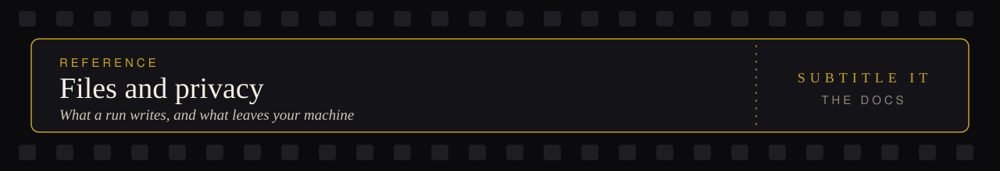
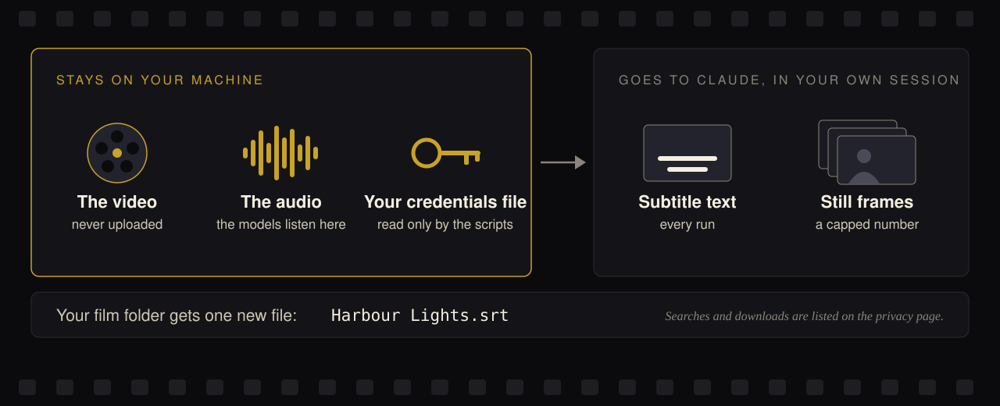

# Files and privacy

> **This document owns:** where a run writes files, and exactly what
> leaves your machine, to whom, and when.

Read this if you want to know what the plugin touches on your disk and
what it sends over the network. Security problems and how the
credentials are stored are in [SECURITY.md](../../SECURITY.md).

## The short version

- **The video never leaves your machine.** Neither does the audio.
- **Subtitle text and a capped number of still frames go to Claude,** as part of your
  own Claude Code session.
- **Your film folders get one new file:** the Turkish `.srt`.

## Where files go

A run writes in three places. Your film folder gets the subtitle and
nothing else.

<b>The three places, exactly</b>

| Place | What is there | When it is deleted |
| --- | --- | --- |
| Next to the video | `<film>.srt` only | Never by the plugin |
| Your settings folder | `preferences.md`, `credentials.json`, `backups/` | Kept when the plugin is uninstalled |
| The plugin's data folder | One work folder per film, the download cache, each script's last result | **Deleted when you uninstall the plugin** |

**Next to the video.** The file has exactly the video's name and is saved
as UTF-8 with a BOM, so TVs find it and show ş, ğ and ı. A file already
there under that name, such as an English `<film>.srt`, is moved to
`backups/` first.

Nothing else is written into your film folders.

**Your settings folder** is `~/.config/subtitle-it/`. On Windows that is
`C:\Users\<you>\.config\subtitle-it\`. A settings folder from before the
plugin was renamed is moved there once, without opening the files in it.

**The plugin's data folder** is `~/.claude/plugins/data/subtitle-it-.../`.
A film's work folder holds the bible, the delivered copy, the saved
frames and the report.

## What leaves your machine

| What | Goes to | When |
| --- | --- | --- |
| Subtitle text | Claude, in your session | Every run |
| Still frames from the video | Claude, in your session | A video input. [On-screen text](ON_SCREEN_TEXT.md#2-save-frames) has the most frames and their size |
| Your OpenSubtitles username and password | OpenSubtitles | When the plugin logs in |
| The video's hash, the title or IMDb id, the year, the languages wanted | OpenSubtitles | Each search |
| The film's title and year | Web search | Once when they are unknown, and when the bible writer and second reader look up the cast and plot |
| Your Hugging Face token | Hugging Face | When audio hints download the pyannote models |
| Nothing | Hugging Face | When the speech model is downloaded. See the note below |
| Requests to download packages | PyPI, download.pytorch.org | The first time each script runs |

### Notes

Four rows of the table have a detail worth knowing: the frames, a
subtitle download, the speech model and the packages.

<b>The four notes</b>

- **Frames** come from the film's opening, its last minutes and around each
  unsure on-screen text. They are also saved in the film's work folder.
- **A subtitle download** comes from the https address OpenSubtitles links
  to, which can be another host. No key or token is sent with it.
- **The speech model** download needs no token and sends none. One
  exception: when `HF_TOKEN` is set in your environment, or you have
  logged in with the Hugging Face command line tool, the Hugging Face
  library sends that token.
- **Packages:** Python packages come from PyPI, and PyTorch from
  download.pytorch.org on Windows and Linux. When no installed Python
  fits a script, uv may also download a Python build.

## What stays on your machine

| What | Why it stays |
| --- | --- |
| The video | Only frames and subtitle text are sent |
| The audio | Audio hints and speech-to-text run locally |
| Your credentials file | Only the scripts read it. The OpenSubtitles login goes only to OpenSubtitles, and the Hugging Face token only to Hugging Face |

Credentials are typed into your own terminal, never into the chat.

## Your part

You are responsible for having the right to use the films and subtitles
you run the plugin on. It reads only the folders you give it, and
downloads from OpenSubtitles under your own account.

---

Related: [Preferences](CONFIGURATION.md) ·
[SECURITY.md](../../SECURITY.md) · [All docs](../INDEX.md)
