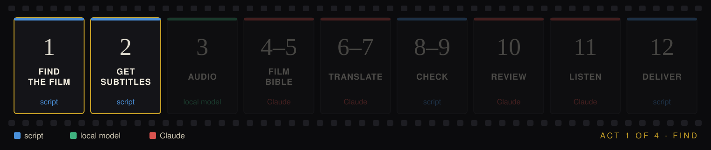

# Act 1: Find

> **This document owns:** the exact rules of steps 0 to 2: finding the
> film, choosing source subtitles, settling the timings and building the
> work folder.

Read this if you need to know why a run picked one subtitle file over
another, or why it moved the timings. Finding text on screen is part of
step 2 and has its own page: [On-screen text](../ON_SCREEN_TEXT.md).

## 0. Start

Before anything else, the run checks that it can start.

- Checks that uv and ffprobe are installed.
- Finds your settings folder and reads your preferences.
- Mentions any delivered file you have edited since, so you can run learn
  mode on it.

## 1. Find the film

`sources.py find` searches your media folders for the name you gave.

| What it finds | What the run does |
| --- | --- |
| Copies of one film | Picks one without asking |
| Different films with a matching name (*Harbour Lights* and *Harbour Lights 2*) | Asks which one. This is the only question a run asks |
| A film given by path, in a folder not listed yet | Adds that folder to your media folders (`sources.py remember`) |
| Nothing, and a listed folder is missing | Names the missing folder, such as an unplugged drive |

## 2. Source subtitles

Step 2 gets the subtitles the translation starts from, settles their
timings and builds the work folder.

### Where they come from

The run tries three places, in this order.

| Order | Place | How |
| --- | --- | --- |
| 1 | On disk | `sources.py local` reads text tracks inside the video, files next to it, and files in a `Subs` or `Subtitles` folder beside it |
| 2 | OpenSubtitles | `opensubtitles.py` searches by the video's hash, then by IMDb id or title |
| 3 | The film's own speech | `transcribe.py` writes subtitles with Whisper. This is the last resort |

### The timing file

One file gives every cue its time. It is the file whose timing is most
certain to fit this exact video.

- Other files are paired onto it by time only when `srt.py fit` says they
  line up after one constant shift. The fit ignores sound descriptions and
  songs.
- A file that needs a shift is rewritten with `srt.py shift` first.

### The work folder

`prepare.py build` and `prepare.py chunks` write two files that every
later step uses.

| File | Holds |
| --- | --- |
| `cues.json` | Every cue with its source text and English text |
| `chunks.json` | The film cut into chunks of about 250 cues, each cut at the longest pause |

### What is taken out of the text

Sound descriptions and speaker names come out of the text before it is
translated. Each name is kept as a hint of who speaks.

<b>The exact rules</b>

| Taken out | From which files | Kept |
| --- | --- | --- |
| Sound descriptions in square brackets: `[door slams]` | Every file | |
| Names in square brackets: `[Mara]`, `[1. Man]` | Every file | |
| Descriptions in parentheses: `(sighs)` | Hearing-impaired files only | A parenthesis that ends in `?` or `!`, or holds a sentence with words on both sides |
| Labels in capitals: `MARA:` | Hearing-impaired files only | Capitals that do not look like a name: `OK:`, `DAY 3:` |

- Each name taken out, in brackets or in capitals, is kept as the cue's
  speaker hint.
- A file counts as hearing-impaired when at least 3% of its cues hold such
  tags or labels, whatever its name says.
- A cue that is only sounds is left out of the translation and of the
  delivered file.
- `Hearing-impaired tags: keep` in your preferences turns all of this off.

### Bare sounds and songs

A cue that is only a sound the audience hears is left out. A cue that is
all lyrics is marked as a song.

These two rules follow the Netflix Turkish style guide. They apply
whatever the hearing-impaired setting says.

<b>The exact rules</b>

- **Bare sounds.** A cue that is only "Oh.", "Hmm?" or "Uh, um..." is left
  out, since the audience hears it.
- **A yes or no said as a sound** ("Uh-huh.") right after a question stays.
  The translator writes it as a word.
- **Songs.** A cue whose words are all lyrics is marked `song`. Steps 6–7
  decide which songs are translated.

How lyrics are recognised:

| The file marks lyrics with | What counts as a song |
| --- | --- |
| `♪`, `♫` or `#` | Every line so marked |
| An opening `♪` with no closing one | That line and the lines after it, up to a line with a `♪` or a dialogue dash |
| Italics alone | A run of at least four whole-italic cues that end no sentence |

Italic narration and phone voices end their sentences, so they stay
speech.

### An existing Turkish subtitle

Step 2 also looks for a human-made Turkish subtitle, first on disk and
then on OpenSubtitles, which leaves out machine translations.

| Rule | Value |
| --- | --- |
| Files tried, a hash match first | 2 at most |
| A file passes `srt.py fit` when | One constant shift lines it up |
| And it covers, of the timing file's spoken cues | 80% at least |

The run stops at the first file that passes, and becomes a polish run.
See [Act 3](ACT_3_TRANSLATE.md#in-a-polish-run).

### The timing file against the speech

A subtitle built into the video can still sit a fraction of a second off
the speech. For a video, step 2 checks this before anything cites a cue
number.

<b>When the check runs</b>

Both of these must hold:

- The timing file did not come from the audio.
- Its language is the one the film is spoken in.

And one of these:

- The timing file is not "certain": it is not a built-in track or an
  OpenSubtitles hash match.
- The other tracks hint that it is off.

| The hint needs | Value |
| --- | --- |
| Other tracks that need a shift the same way | 3 at least |
| Their share of the tracks that fit | More than half |
| The shift they need | More than 300 ms |

Tracks in the timing file's own language do not count for that hint. A
second English track usually shares the first one's times.

<b>How it measures</b>

| Setting | Value |
| --- | --- |
| Stretches transcribed with Whisper | 6, of 3 minutes each |
| Words looked for near each cue's start | The cue's first 3 |
| Time on a GPU | About a minute |

`transcribe.py sync` takes the gap between each cue and its words, over
every cue matched once. That gives the median offset, its spread and an
offset for each stretch.

Matching words, not speech starts, keeps a neighbouring line from passing
for the right one in dense talk.

<b>When it moves the file</b>

| Condition | Value |
| --- | --- |
| The median offset is more than | 300 ms |
| Lines matched, at least | 30 |
| Share of them within 400 ms of the median | Half |
| Two stretches may differ by at most | 700 ms |
| Taken off the median first, because Whisper's word starts come early | 150 ms |

- When every condition holds, the files are shifted with `srt.py shift`
  and `build` runs again.
- An offset that changes through the film is a different cut or drift. No
  single shift fixes that, so nothing moves.
- The other tracks never move the file alone. They only decide that the
  check runs. When it gives no clear answer, they let the sync check of
  step 3 accept a weak result that agrees with them.

The 150 ms comes from two films whose tracks were in sync: their median
gaps were 158 and 164 ms.

---

Previous: [How a run works](../ARCHITECTURE.md) · Next:
[Act 2: Understand](ACT_2_UNDERSTAND.md) · [All docs](../../INDEX.md)
