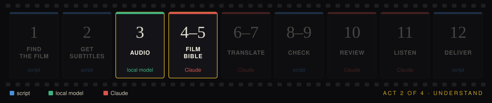
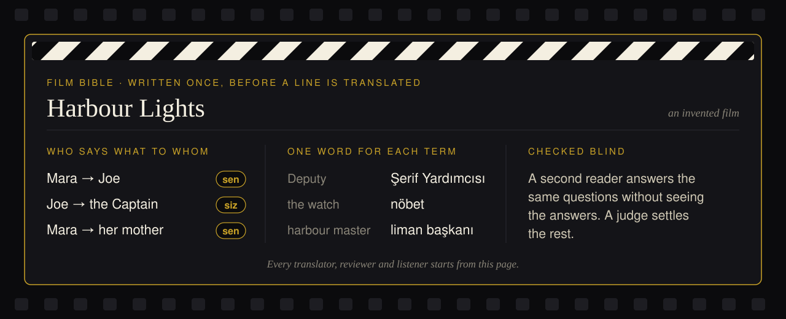

# Act 2: Understand

> **This document owns:** the exact rules of steps 3 to 5: the voices from
> the audio, the film bible, and the blind check of the bible.

Read this if a character got the wrong *sen* or *siz*, a term was
translated two ways, or you want to know how a decision was settled.

## 3. Speaker hints

This step is optional. `speakers.py` finds which voice speaks each line,
and checks that the subtitles are in sync with the audio.

| Setting | Value |
| --- | --- |
| Stretches the sync check transcribes, spread over the film | 5, of 3 minutes each |
| Offsets the sync check tries | Up to 20 seconds either way |
| A file is shifted when it is off by more than | 300 ms |

- Everything runs on your machine.
- It runs in the background while the bible is written, since it takes
  several minutes.

### The sync check

This check is skipped when the timing file came from the audio, and when
step 2's check already found the file in sync or shifted it. When step
2's check gave no clear answer, this one still runs.

Otherwise it slides the subtitles against the speech, and keeps the
offset where the two fit best.

<b>The exact rules</b>

1. It tries every offset in its range.
2. It keeps the one where most speech starts land on a cue start.
3. That offset must stand well above chance, and above the best other
   offset. Chance is the median count over all offsets.

Fast, overlapping talk puts many speech starts near some cue at any
offset. The two comparisons in point 3 still give a clear answer there.

| Case | What happens |
| --- | --- |
| The subtitles are off by more than the limit | They are shifted with `srt.py shift`, and the voices are matched again |
| The other tracks agree on an offset, and the best offset is within 300 ms of theirs and beats every offset away from it | It is taken, even when it does not stand out on its own |

After a shift, `build` runs again and moves the on-screen cues with it.
[On-screen text](../ON_SCREEN_TEXT.md#after-a-timing-shift) has the rules.

### When a voice is not trusted

The audio can gather several characters into one voice.

| A voice gives no hint when | Value |
| --- | --- |
| Its cues with a speaker label number | 6 at least |
| And no character holds, of those cues | Two thirds |

The *sen* and *siz* check leaves that voice's cues alone.

A hint that is wrong in one cue out of three is worse than none.

## 4. Film bible

One agent reads the film once. It writes down the decisions every
translator must share.

| File | Holds |
| --- | --- |
| `bible.md` | The characters, the film's world and how its people talk, who says *sen* or *siz* to whom, fixed terms |
| `glossary.json` | Each preferred Turkish term, with the wrong variants to avoid |
| `decisions.json` | Each decision as a question, its answer, the cues that support it, and how sure it is |
| `songs.json` | The songs that carry the story, by cue range. Written when the film has song cues |

- **The film's world** covers the words that world needs, such as "adak"
  for an offering to a god, and the words whose tone belongs elsewhere.
- **A musical** is marked `"musical": true` in `songs.json`. Its Turkish
  is delivered with no `♪` or `♫` on any line.

### Sen and siz

*Sen* and *siz* are read from the tone of each scene, not only from the
relationship on paper.

<b>The exact rules</b>

- People at ease say *sen*.
- A pair can shift for one scene, such as a cold *siz* in a fight, and
  shift back.
- For an unclear pair, the fallback is *siz* only for formal relations.
  Adults of about the same age at ease get *sen*.

What a speaker calls the listener ("man", "honey", "kid") goes on the
same pair's line. Turkish picks that word from what the two are to each
other. One speaker's "man" can be "dostum" to a policeman and "kanka" to
a friend.

### The voices join the bible

The bible writer works from the text while the audio step runs. Once the
voices are in:

1. A voice mapper agent decides which character each voice is.
2. `bible.py voices` adds those answers to the bible.

The check in step 5 then covers the voices too.

## 5. Check the bible

A bible written by one reader can be confidently wrong. So a second
reader answers the same questions without seeing it.

<b>Who does what, in order</b>

| Order | Who | Does |
| --- | --- | --- |
| 1 | `bible.py questions` | Strips the answers from the decisions |
| 2 | Second reader | Answers the same questions on its own, from the subtitles and a web search for the cast and plot |
| 3 | `bible.py voice-questions` and the second reader | Do the same for the voice questions, beside the voice mapper |
| 4 | `bible.py compare` | Locks what both agree on, and names the questions the second reader skipped |
| 5 | Bible judge | Reads the cited cues for the rest, and decides from the evidence or by a safe default |
| 6 | `bible.py apply` | Writes the result |

- The second reader starts as soon as the bible is written, while the
  audio step may still run.
- It is asked once more for any question it skipped.
- Anything settled by a safe default goes into the report.

---

Previous: [Act 1: Find](ACT_1_FIND.md) · Next:
[Act 3: Translate](ACT_3_TRANSLATE.md) · [All docs](../../INDEX.md)
