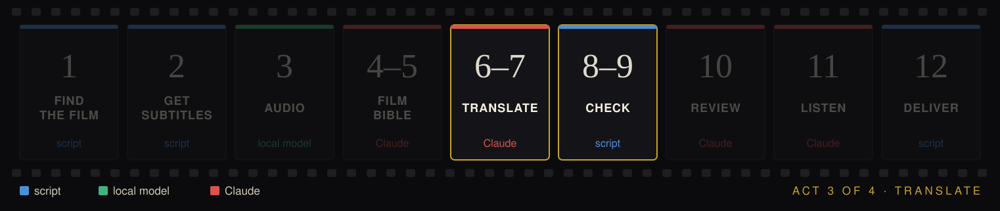
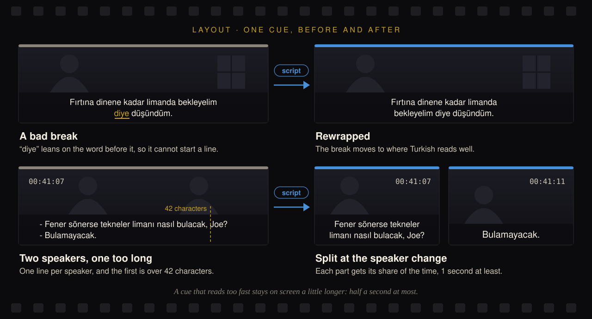

# Act 3: Translate

> **This document owns:** the exact rules of steps 6 to 9: which songs are
> translated, how the translators run, how a polish run differs, the fix
> rounds and how every cue is laid out.

Read this if you want to know how the Turkish is written and what
happens to a cue that fails a check. The checks themselves are listed in
[Checks](../CHECKS.md).

## 6–7. Translate

The film is translated in chunks, side by side. The songs are settled
first, and a polish run takes another road.

### Songs first

`prepare.py songs` applies the `Songs` setting from your preferences.

| Setting | What is translated |
| --- | --- |
| `story` (default) | Only the songs in `songs.json`: the ones that carry the story |
| `skip` | No songs |
| `all` | Every song |

A song that is not translated gets no line in any chunk and is not
delivered. The chunks are written again without it.

### The translators

One translator agent per chunk, all started at once. Each one gets:

- the Turkish language pack, `pack-tr.md`
- the film bible
- your preferences
- its neighbours' chunks, for context

### Why medium effort

The translators run at medium reasoning effort, whatever effort your
session uses. This is set in `agents/translator.md`. A `Translator model`
of `sonnet` runs at medium too, and so do the fix rounds of step 9, which
use the same agent.

<b>The test behind this choice</b>

| | Low effort | Medium effort |
| --- | --- | --- |
| Cost per film | About 17% less | The baseline |
| Blind test of 100 cues, judged on meaning | Tied | Tied |
| Second review on one 2026 film, judged on natural Turkish | One line in five that a Turkish speaker would not say | Not reviewed |

The blind test judged meaning, not how natural the Turkish sounds. The
second review did, so the translators went back to medium.

### In a polish run

A polish run starts from a human-made Turkish subtitle. There are no
translators.

| Order | Step | What it does |
| --- | --- | --- |
| 1 | `polish.py seed` | Puts the human file's text on the timing file's cues |
| 2 | `polish.py flags` | Lists the cues to fix |
| 3 | Polish fixer | One agent changes only those cues |
| 3 | Reviewers | Start in the same message and read the film while the fixer works |

Where the fixer and a reviewer change the same cue, the reviewer's
version wins. It fixes that cue's flags too.

The exact rules, by topic:

<b>What seeding does with odd lines</b>

- A timing cue the human file does not cover gets no text. The check
  counts it as missing, and the fixer translates it.
- A Turkish line that lands on no cue is kept with its time in
  `polish_placement.json`.
- The report lists such lines when no delivered on-screen cue sits over
  them. The human translator may have subtitled a sign the tracks lack.

<b>What gets flagged</b>

| Flagged | Not flagged |
| --- | --- |
| Cues that fail a check | *Sen* and *siz*: the human file is the evidence for them |
| Lines left in English | `repeat drift`: a human file words a stock phrase for each scene |
| Crude lines the Turkish tones down | |
| Lines that may sit on the wrong cue | |
| `bible repeat`: a line the bible says is said word for word | |
| `term rendering`: every cue whose source says a bible term | |

<b>The human file decides sen and siz</b>

`polish.py seed` runs before the bible check. So `bible.py compare` can
count the human file's *sen* and *siz* lines for each pair, and the
judge gets the counts.

| Rule | Value |
| --- | --- |
| A pair goes to the judge when human lines, at the same cues, use another form than both readers give | 3 or more |
| The judge follows the human file where its lines for the pair use one form | Three quarters of them |

- A seeded line keeps its form. The fixer and the reviewers change it only
  when the English line itself shows the other form.
- They write the reason on an `#address:` line under the cue.
- The check lists every line whose form differs from the human file's, as
  `address_changes` in `checks.json`. It warns on each one with no reason.
- A line written from scratch takes the human file's form for the same
  pair in the nearest scene.

## 8–9. Assemble and check

`assemble.py check` joins the chunks and checks every cue.

- It first removes position tags such as `{\an8}`, so every line stays at
  the bottom of the screen.
- **Hard fails** go back to the chunk's translator.
- **Warnings** go to the reviewers in step 10.

[Checks](../CHECKS.md) lists every hard fail and warning.

### Fix rounds

| Round | Who fixes |
| --- | --- |
| 1 and 2 | The chunk's translator |
| 3 | The same agent on a stronger model |

A cue that still fails after round 3 is delivered as it is (step 12
delivers with `--force`), and the report lists it under "Check after
watching". When a cue is missing or a file is malformed, the check writes
no draft and the run stops.

Each round starts with `assemble.py fixround`. It writes every failing
cue's checks, its source and its current Turkish to the work folder. The
translator edits that text, so the reviewed wording and the bible's terms
stay.

### Layout

The last part of the check lays out every cue as it is shown
(`layout.py`).

| Rule | Value |
| --- | --- |
| Lines per cue | 2 at most |
| Characters per line | 42 at most |
| A cue with two speakers | One line per speaker |

A cue that breaks badly is rewrapped. A two-speaker cue that does not
fit is split, and a fast cue stays on screen a little longer.

<b>Where a line breaks</b>

**Where a line breaks** follows the Netflix Turkish style guide (`turkish.py`):

1. After a sentence end or a comma.
2. Otherwise before a conjunction.
3. Never so that the second line starts with a word that leans on the one
   before: "gibi", "diye", "mi", "de".
4. Never one word alone on a line, and "bir" stays with the word after
   it.

A cue that fits two lines is rewrapped. So is a two-line cue that fits
but breaks badly, when a better break fits.

<b>A cue that does not fit, or reads too fast</b>

**A two-speaker cue that does not fit** is split at the speaker change
into one cue per speaker.

| Rule of the split | Value |
| --- | --- |
| Each part's time | In proportion to its length |
| Shortest part | 1 second, taken from the others when needed |
| Between the parts | The file's usual gap |
| The split is made only when every part reads at | 17 characters a second or less |

Anything else is a hard fail.

**A fast cue gets more time on screen.** A cue that reads above the same
speed stays up into the silence before the next cue, until it reads at
that speed.

| Limit on the extra time | Value |
| --- | --- |
| Longer by at most | Half a second |
| Never closer to the next cue than | The file's usual gap |
| Never on screen longer than | 7 seconds |

A split cue gives the extra time to its last part.

### Cue numbers

The draft is numbered from 1, as delivered. `cue_map.json` leads each
delivered cue back to the timing file's cue. The rest of the work folder
keeps the timing file's numbers.

---

Previous: [Act 2: Understand](ACT_2_UNDERSTAND.md) · Next:
[Act 4: Finish](ACT_4_FINISH.md) · [All docs](../../INDEX.md)
