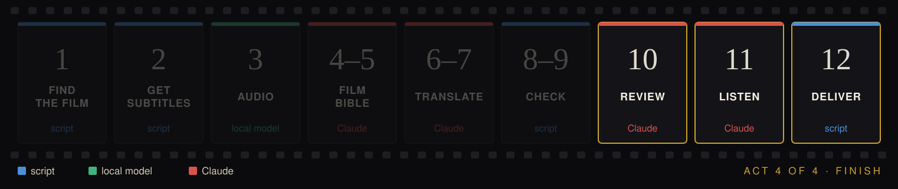

# Act 4: Finish

> **This document owns:** the exact rules of steps 10 to 12: the review
> against the source, the listen pass, the delivered file and the report.

Read this if you want to know how a line is judged before delivery, or
where the opening and closing credit lines are placed.

## 10. Review

The reviewers compare every Turkish line with its source.

### The parts

`assemble.py reviewparts` cuts the film into parts of about 250 cues.
Each part ends at the longest pause near an even cut.

<b>What a part file holds</b>

A part file holds:

- its cues, side by side with the source
- 20 cues of context on each side
- each cue's notes, cut short: the check's warnings, the polish fixer's
  flags and the translators' flags

A reading speed note shows only where the Turkish alone is fast.

A cue that is on-screen text shows `on-screen text` as its speaker, here
and in the listeners' files. So it is read as text and not as speech.

### The reviewers

One reviewer per part, all at the same time. A reviewer reads its part
file, the language pack, the bible and, in a polish run, your
preferences, and nothing else.

<b>What a part costs, and the effort</b>

A part therefore costs little more than its own cues: about 50,000
tokens.

The reviewers run at medium reasoning effort, whatever your session
uses. That is the effort the split review was tested and passed at.

### What a reviewer asks of each line

1. Is everything said there: each clause, question, name and number?
2. Is it on the right cue?
3. Are the case endings and verb forms right?
4. Is *sen* or *siz* right for who speaks to whom?
5. Are the names and terms the bible's?
6. Would a Turkish speaker say it this way?
7. Where only the Turkish is too fast, can it be shorter without losing
   anything?

A line that passes stays word for word.

### Two rules for hard calls

- **The scene decides sen and siz.** The bible is the default. A reviewer
  never turns a natural *sen* into *siz* only to match the bible, and
  lists each cue where it departs from it.
- **Meaning comes before reading speed.** A fast line is shortened only by
  rephrasing or dropping filler. Never by dropping a clause, a question, a
  name or a second sentence.

Each reviewer writes its own fix file and notes. `assemble.py reviews`
joins the notes into `review.md`.

Then the check runs again. A new hard fail gets one more fix round, as in
step 9 (`fixround --round post`), and that round's fixes win over the
review's.

### In a polish run

The reviewers keep the human translator's wording where it is right.

<b>The exact rules</b>

- A reviewer rewrites a human line that leaves out part of what is said,
  and keeps its wording where it is right.
- A word the bible prefers is not by itself a reason to change a human
  line. The human file is the evidence for its words, as it is for its
  *sen* or *siz*.
- `polish.py soft` then lists the lines that are still softer than the
  English swearing. The polish fixer restores them once. Any line still
  soft goes to "Check after watching".

## 11. Listen

The reviewers catch what is missing. They do not always catch what
sounds translated. So the listeners read the other way round.

### How a listener reads

1. It reads the finished Turkish alone, in order, as a viewer reads it.
2. It has the bible's notes on how each character talks, and each pair's
   tone.
3. A line that does not sound like this person saying this to this
   listener gets a fix.
4. Only then does it read the English, to keep everything said.

In a polish run the listeners work only on the lines the run wrote.

<b>The polish run's rules</b>

- A line that still says the human file's words is marked `human`. It is
  read for the scene and left alone.
- A part with only such lines gets no listener.
- The reviewers of a polish run can change many lines, 616 of 1,351 on
  one film. Those need the viewer's ear too.

### The parts and the budget

`assemble.py listenparts` saves the Turkish as it is, then cuts the
spoken cues into parts of about 480.

Every cue also gets a budget that a listener's edit must stay within.

<b>How the budget is set</b>

Each cue gets a budget: the most characters it may hold. It is the
largest of these three:

- 17 characters a second over the most time the cue can be shown
- the cue's length now
- the first draft's length

So a line the review cut short can always go back.

The part file also names the cues that hold one source sentence, and the
cues that say the same line elsewhere in the film.

### The gate

`assemble.py listengate` is the safety net, as code. It runs the checks
on the text before and after the listener's edits, without writing
anything. It compares the problems by cue and kind.

<b>When an edit is dropped</b>

| An edit is dropped when | |
| --- | --- |
| It changes a human line | Polish runs only |
| It goes over its budget | |
| Its cue, sentence or repeated line gains a hard fail | |
| It gains a new warning | About a repeated line, a split sentence, *sen* or *siz*, or a term |

Then it checks again, and drops whatever still causes a new problem.

### The second opinion

One reviewer reads each kept edit beside the line before it. It keeps
the edit, or writes the old line back. It never writes a third version,
which no check would see.

- If the last check finds a hard fail on a cue the listener changed,
  `listendrop` drops that edit.
- A hard fail on any other cue gets that same one fix round.
- `review.md` ends with the counts: kept, dropped by the gate with the
  reason, and written back.

### Which fix wins

Fix files apply in this order, and a later one wins on the same cue.

| Order | Fix files |
| --- | --- |
| 1 | Every fix file that existed when the listeners started |
| 2 | The listeners' files |
| 3 | The second opinion's file |
| 4 | Any fix file written after that |

## 12. Deliver

### The file

`assemble.py deliver` writes `<film>.srt` next to the video.

| Property | Value | Why |
| --- | --- | --- |
| Name | Exactly the video's name | A TV playing the film picks it up |
| Encoding | UTF-8 with a BOM | TVs show ş, ğ and ı |
| A file already there | Moved to the backups folder | The result says what it was: `earlier delivery`, `Turkish` or `not Turkish` |

<b>An .srt input, and earlier deliveries</b>

- **For an `.srt` input,** the name keeps the input's name with `tr` as
  its language. The input is never written over.
- **Earlier deliveries under another name** go to the backups folder too,
  so the TV finds one Turkish file. This happens when the file is
  delivered next to the video (`--video`).
- **Which files those are.** Examples are a `<film>.tr.srt` from before
  0.6.2, or a file from the plugin's old name, turkish-subtitles.
  `deliver` knows them from the `delivered.json` of every work folder, and
  moves only a file that still holds Turkish.
- **The same records serve two more readers.** `sources.py local` reads
  them, so a delivered file is never taken as a source. Learn mode finds
  old deliveries through them.

### The credit

Unless your preferences turn it off, two lines are added.

| Line | Where |
| --- | --- |
| "İyi seyirler." | In the silence before the first line |
| "Görüşmek üzere." | After every translated line, half a second later at the earliest. It lasts 4 seconds |

"After every translated line" counts spoken lines, kept songs, on-screen
story text and an after-credits scene. Nothing translated ever follows
the goodbye.

### Where the goodbye starts

The frames read in step 2 show the end cards: credits, a title card,
closing text or a logo that start after the last line.

| The picture shows | The goodbye starts | Rule name |
| --- | --- | --- |
| A black stretch just before the end cards | On the black | `cut to black before the end cards` |
| End cards, no such black | On the first end card | `first end card` |
| Neither, or the input is an `.srt` | 3 seconds after the last line | `after the last line` |
| Under 3 seconds of video left for it | Nowhere: it is left out | `no room` |

The result's `goodbye` says which rule placed it.

<b>What counts as the end, and as black</b>

| Thing | Counts when |
| --- | --- |
| The film's end | A card is followed within 10 seconds by a card with other text |
| The film's end, second way | A card is still on screen in the last frame saved, and the saved frames ran to the end of the video |
| The black stretch | The end starts inside it or within 3 seconds after it, and it is still black half a second after the last line |
| The record of black stretches, `ends.json` | It covers half a second after the story's end to 30 seconds after it |

- A stray logo inside the story, or one card read twice, does not start
  the film's end.
- Black is found by ffmpeg's blackdetect with `pic_th=0.98`, so a title
  fading in over the black still counts.
- A fade to black inside the last scene, with no end cards right after
  it, never counts, however late it comes.
- The rule for `ends.json` lets a later check hold the last line a little
  longer without losing the record.

**The goodbye stays inside the video's length.** It moves earlier when it
must, but never before its earliest start, and then ends with the video.

### The report

`report.md` in the work folder has three parts worth knowing.

| Section | Holds |
| --- | --- |
| On-screen text | Every on-screen cue delivered, and what was left out and why |
| Time and usage | The run's wall-clock time, the time of each step group, and each agent kind's count, tokens and time |
| Check after watching | What could not be settled for certain, with timestamps |

"Check after watching" is kept out of the chat, so nothing is spoiled.

<b>The usage figures: what they miss and where they come from</b>

**What the usage section cannot see.** A run does not know the main
session's own tokens, or the split into new and cached tokens. So the
report gives no cost in money.

[Numbers](../NUMBERS.md) has figures measured from full session records.

`usage.py summary` saves the same figures as `usage.json` in the work
folder, so several films can be compared.

**Where the figures come from**

| Figure | Source |
| --- | --- |
| Time of each step group | Marks that `usage.py step` makes at the start of each group |
| Each agent kind's count, tokens and time | The agents' completion notices |

A run does not wait for those notices, which can come many minutes after
the work. `usage.py wait` returns once an agent's output files exist and
have stopped changing, and the run goes on from there.

### Finding a cue again

The cue map is kept with the delivered copy and with each backup, so the
report, learn mode and old files can still name each cue.
`assemble.py where` turns a work folder cue number into its delivered
number and time.

---

Previous: [Act 3: Translate](ACT_3_TRANSLATE.md) · Next:
[After a run](../../guides/AFTER_A_RUN.md) · [All docs](../../INDEX.md)
